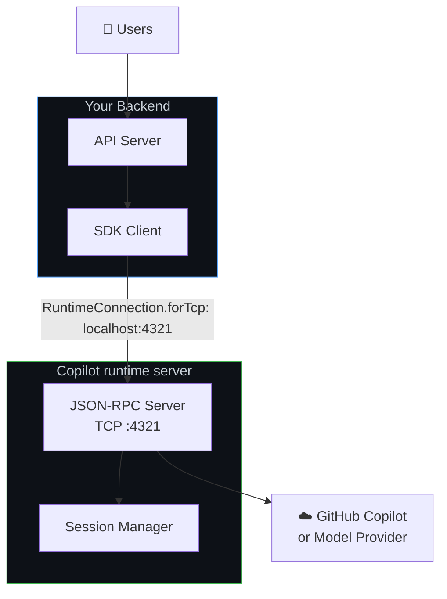
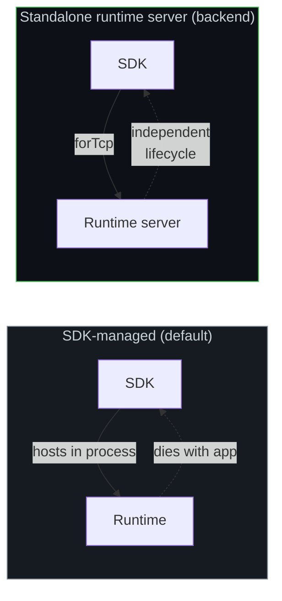
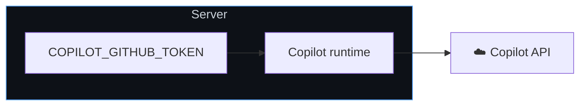
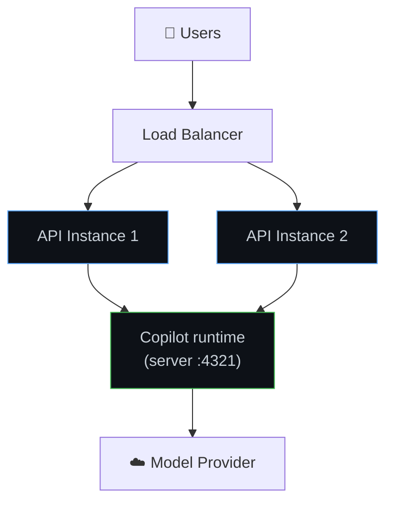
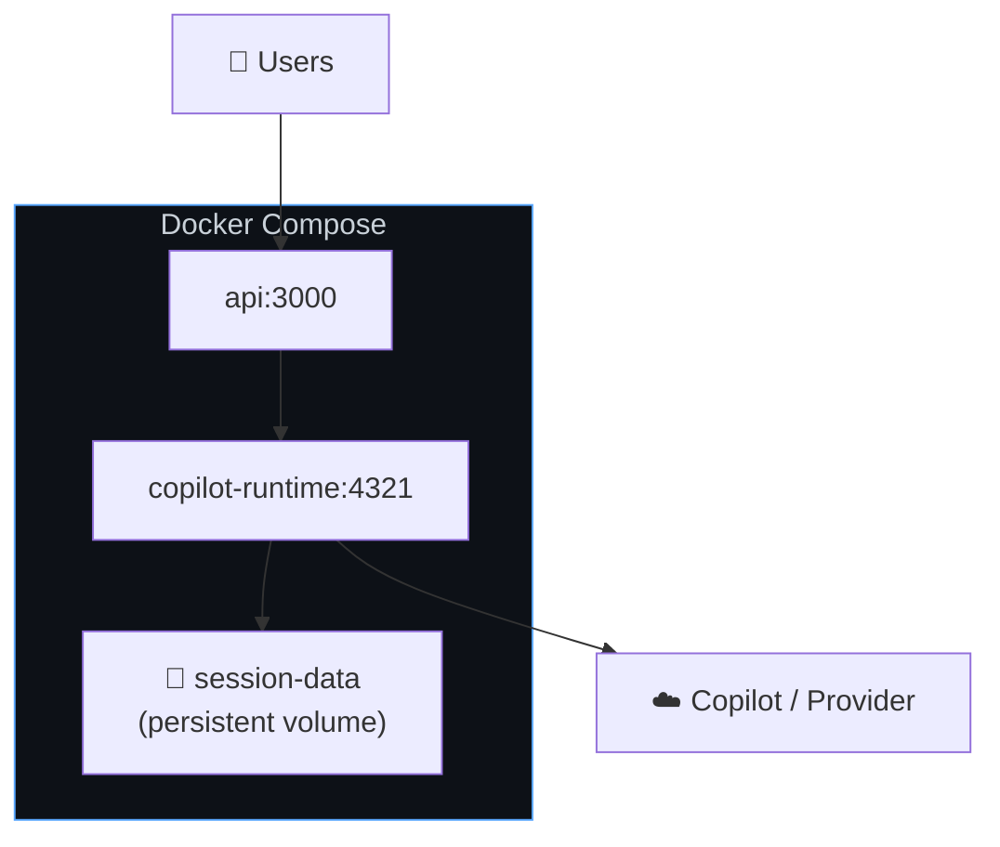

# Backend services setup

Run the SDK in backends, APIs, microservices and workers. Connect to a standalone Copilot runtime server over plaintext TCP JSON-RPC (no TLS), using its host name or IP address and port, without an `http://` or `https://` scheme.

**Best for:** Web app backends, API services, internal tools, CI/CD integrations, any server-side workload.

## How it works

The Copilot runtime is a standalone component, separate from the Copilot CLI. By default the SDK hosts the runtime in your application process; for backends, you can instead run the runtime yourself as a **runtime server** (`copilot-runtime --server`). Your backend attaches to it over TCP with the client's `runtime` option (`RuntimeConnection.forTcp(host, port)`, or `TCPConnection` in Go). You don't need the Copilot CLI installed.



**Key characteristics:**

- The runtime runs as a persistent server process (not spawned per request)
- SDK connects over TCP, so the runtime and your app can run in different containers
- The runtime is multi-tenant: many SDK clients and many concurrent sessions can share one runtime server
- Works with any auth method (GitHub tokens, env vars, BYOK)

To serve multiple users from one runtime, configure SDK clients with `mode: "empty"`, pass user credentials per session, and explicitly allow tools for each session. See [Multi-Tenancy & Server Deployments](./multi-tenancy.md) for the full pattern.

## Architecture: SDK-managed vs. standalone runtime



With SDK-managed hosting, the SDK loads the runtime into your application process by default (see [In-process runtime](./in-process-runtime.md)), or starts it as a child process when you select `RuntimeConnection.forSpawnedStdio()` or `RuntimeConnection.forSpawnedTcp()`. Either way, the runtime stops with your app. A standalone runtime server keeps running independently and can serve many applications and users.

## Step 1: start the runtime server

Get the `copilot-runtime` executable from the `github-copilot-<version>-<platform>.tgz` assets on the [GitHub Copilot CLI releases](https://github.com/github/copilot-cli/releases); inside the tarball it's at `package/prebuilds/<platform>/copilot-runtime`. Use the runtime version your SDK expects: the SDK and runtime negotiate a protocol version when the client connects, and incompatible pairs fail. Extract the whole package and keep its layout intact: the executable loads `runtime.node` from its own directory, and the runtime finds its bundled built-in agents, skills and search tools in the package root. Run it as a background server:

```bash
# Start with a specific port
copilot-runtime --server --port 4321

# Or let it pick a random port (prints the port it listens on)
copilot-runtime --server
# Output: CLI server listening on port 52431
```

By default the runtime server only accepts connections from loopback (`127.0.0.1`), where it needs no authentication. To accept connections from other hosts—for example from another machine on your network—bind to a non-loopback address with `--host`. A non-loopback bind exposes the full runtime (sessions, shell and file tools, the configured GitHub token) to anything that can reach the port, so the server **requires** a connection token in that case and refuses to start without one. Set `COPILOT_CONNECTION_TOKEN` to a non-empty shared secret on the server, and pass the same value as `connectionToken` from the SDK client:

```bash
# Generate a secret once and keep it (for example in your secret store)
export COPILOT_CONNECTION_TOKEN="$(openssl rand -hex 32)"
copilot-runtime --server --host 0.0.0.0 --port 4321
```

Without `COPILOT_CONNECTION_TOKEN`, a non-loopback bind fails with `refusing to bind the runtime server to non-loopback host ... without a connection token`. Keep the token out of shell history and process arguments, and prefer loopback with an authenticating reverse proxy where you can.

The runtime stores persistent state (including sessions) in the normal Copilot home (`~/.copilot`) unless you set `COPILOT_HOME` or pass `--config-dir <directory>`. Pass `--session-idle-timeout <seconds>` to clean up inactive sessions automatically. To write a redacted process log, set `COPILOT_RUNTIME_PROCESS_FILE_LOGGING=1`; logs go to the Copilot home's `logs` directory unless you pass `--log-dir <directory>`, and `--log-level` sets the verbosity.

For production, run it as a system service or in a container.

> [!NOTE]
> There is no official pre-built Docker image for the Copilot runtime. You can build your own from the `github-copilot-<version>-linux-<arch>.tgz` tarballs attached to the [GitHub Copilot CLI releases](https://github.com/github/copilot-cli/releases). Set `COPILOT_VERSION` to the runtime version your SDK expects. The standalone `copilot-linux-*.tar.gz` CLI archives don't include the runtime. The Dockerfile below extracts the whole package so the runtime keeps its bundled assets, and links the executable onto `PATH`.

```dockerfile
FROM debian:bookworm-slim
# Required: the runtime version your SDK expects, for example --build-arg COPILOT_VERSION=<version>
ARG COPILOT_VERSION
RUN test -n "${COPILOT_VERSION}" || (echo "Set --build-arg COPILOT_VERSION" && exit 1) \
    && apt-get update \
    && apt-get install -y --no-install-recommends ca-certificates wget \
    && ARCH=$(dpkg --print-architecture) \
    && case "${ARCH}" in amd64) COPILOT_ARCH="x64" ;; arm64) COPILOT_ARCH="arm64" ;; *) echo "Unsupported: ${ARCH}" && exit 1 ;; esac \
    && wget -q "https://github.com/github/copilot-cli/releases/download/v${COPILOT_VERSION}/github-copilot-${COPILOT_VERSION}-linux-${COPILOT_ARCH}.tgz" -O runtime.tgz \
    && mkdir -p /opt/copilot \
    && tar -xzf runtime.tgz -C /opt/copilot --strip-components=1 \
    && ln -s "/opt/copilot/prebuilds/linux-${COPILOT_ARCH}/copilot-runtime" /usr/local/bin/copilot-runtime \
    && rm runtime.tgz \
    && apt-get purge -y wget && apt-get autoremove -y && rm -rf /var/lib/apt/lists/*
ENTRYPOINT ["copilot-runtime", "--server"]
```

```bash
# Build the image
docker build --build-arg COPILOT_VERSION=<version> -t copilot-runtime:latest .

# For remote deployments (Kubernetes, ACI, etc.), push to your registry
docker tag copilot-runtime:latest your-registry/copilot-runtime:latest
docker push your-registry/copilot-runtime:latest
```

```bash
# Docker — must bind to 0.0.0.0 so the container's published port is reachable;
# a non-loopback bind requires COPILOT_CONNECTION_TOKEN, forwarded below from the
# value exported above (`-e NAME` with no value keeps it out of the command line).
# The image's entrypoint already passes --server.
docker run -d --name copilot-runtime \
    -p 4321:4321 \
    -e COPILOT_GITHUB_TOKEN="$TOKEN" \
    -e COPILOT_CONNECTION_TOKEN \
    copilot-runtime:latest \
    --host 0.0.0.0 --port 4321

# systemd (the executable's path inside the extracted runtime package)
[Service]
ExecStart=/opt/copilot/prebuilds/linux-x64/copilot-runtime --server --port 4321
Environment=COPILOT_GITHUB_TOKEN=your-token
Restart=always
```

## Step 2: connect the SDK

> [!IMPORTANT]
> If you started the server with a non-loopback `--host` (for example the Docker setup above), it requires a connection token. Pass the same `COPILOT_CONNECTION_TOKEN` value to the client with `RuntimeConnection.forTcp`, for example `RuntimeConnection.forTcp("your-host", 4321, { connectionToken: process.env.COPILOT_CONNECTION_TOKEN })` (Node), `RuntimeConnection.for_tcp("your-host", 4321, connection_token=...)` (Python), or the equivalent option in your language: `ConnectionToken` on `copilot.TCPConnection` (Go), the third argument of `RuntimeConnection.ForTcp` (.NET), `RuntimeConnection.forTcp(...).setConnectionToken(...)` (Java) or `connection_token` on `TcpRuntimeOptions` (Rust). A loopback server (the default `copilot-runtime --server`) needs no token.

A client attached with `forTcp` doesn't own or configure the runtime server, so don't set runtime startup options on it. The SDK rejects default authentication (`github.token`, `github.useLoggedInUser`) and the telemetry exporter (`observability.telemetry`) on an attached client, and the runtime home (`baseDirectory`) and session idle timeout (`sessionIdleTimeoutSeconds`) exist only on SDK-owned connections. Configure these, and the runtime log level, on the runtime server instead: for example `COPILOT_GITHUB_TOKEN`, OpenTelemetry environment variables such as `OTEL_EXPORTER_OTLP_ENDPOINT`, `COPILOT_HOME` or `--config-dir`, `--session-idle-timeout`, and `--log-level`. Session options, including per-session GitHub tokens, work as usual.

<details open>
<summary><strong>Node.js / TypeScript</strong></summary>

<!-- docs-validate: hidden -->

```typescript
import { CopilotClient, RuntimeConnection } from "copilot-sdk-supercharged";

// Provided by your web framework and auth layer
declare const userId: string;
declare const user: { githubToken: string };
declare const req: { body: { message: string } };
declare const res: { json(body: unknown): void };

const client = new CopilotClient({
    runtime: RuntimeConnection.forTcp("localhost", 4321),
    mode: "empty",
});

const session = await client.createSession({
    sessionId: `user-${userId}-${Date.now()}`,
    model: "auto",
    tools: {
        availableTools: ["custom:*"],
    },
    github: {
        token: user.githubToken,
    },
});

const response = await session.sendAndWait({ prompt: req.body.message });
res.json({ content: response?.data.content });
```

<!-- /docs-validate: hidden -->

```typescript
import { CopilotClient, RuntimeConnection } from "copilot-sdk-supercharged";

const client = new CopilotClient({
    runtime: RuntimeConnection.forTcp("localhost", 4321),
    mode: "empty",
});

const session = await client.createSession({
    sessionId: `user-${userId}-${Date.now()}`,
    model: "auto",
    tools: {
        availableTools: ["custom:*"],
    },
    github: {
        token: user.githubToken,
    },
});

const response = await session.sendAndWait({ prompt: req.body.message });
res.json({ content: response?.data.content });
```

</details>

<details>
<summary><strong>Python</strong></summary>

```python
import time
from copilot import CopilotClient, RuntimeConnection
from copilot.session import PermissionHandler

user_id = "123"
message = "Hello!"

client = CopilotClient(
    mode="coding-agent",
    runtime=RuntimeConnection.for_tcp("localhost", 4321),
)
await client.start()

session = await client.create_session(
    model="auto",
    session_id=f"user-{user_id}-{int(time.time())}",
    permissions={"on_request": PermissionHandler.approve_all},
)

response = await session.send_and_wait(message)
```

</details>

<details>
<summary><strong>Go</strong></summary>

<!-- docs-validate: hidden -->

```go
package main

import (
	"context"
	"fmt"
	copilot "github.com/microsoft/copilot-sdk/go/v2"
	"time"
)

func main() {
	ctx := context.Background()
	userID := "user1"
	message := "Hello"

    client := copilot.NewClient(&copilot.ClientOptions{
        Mode: copilot.ModeCodingAgent,
        Runtime: copilot.TCPConnection{Host: "localhost", Port: 4321},
    })
	client.Start(ctx)
	defer client.Stop()

	session, _ := client.CreateSession(ctx, &copilot.CreateSessionOptions{
		SessionID: fmt.Sprintf("user-%s-%d", userID, time.Now().Unix()),
		Model:     "auto",
	})

	response, _ := session.SendAndWait(ctx, copilot.MessageOptions{
		Prompt: message,
	})
	_ = response
}
```

<!-- /docs-validate: hidden -->

```go
client := copilot.NewClient(&copilot.ClientOptions{
    Mode: copilot.ModeCodingAgent,
    Runtime: copilot.TCPConnection{Host: "localhost", Port: 4321},
})
client.Start(ctx)
defer client.Stop()

session, _ := client.CreateSession(ctx, &copilot.CreateSessionOptions{
	SessionID: fmt.Sprintf("user-%s-%d", userID, time.Now().Unix()),
	Model:     "auto",
})

response, _ := session.SendAndWait(ctx, copilot.MessageOptions{
	Prompt: message,
})

```

</details>

<details>
<summary><strong>.NET</strong></summary>

<!-- docs-validate: hidden -->

```csharp
using Microsoft.Copilot;

var userId = "user1";
var message = "Hello";
var client = new CopilotClient(new CopilotClientOptions
{
    Mode = CopilotClientMode.CodingAgent,
    Runtime = RuntimeConnection.ForTcp("localhost", 4321),
});
await using var session = await client.CreateSessionAsync(new CreateSessionOptions
{
    SessionId = $"user-{userId}-{DateTimeOffset.UtcNow.ToUnixTimeSeconds()}",
    Model = "auto"
});
var response = await session.SendAndWaitAsync(new MessageOptions
{
    Prompt = message
});
```

<!-- /docs-validate: hidden -->

```csharp
var client = new CopilotClient(new CopilotClientOptions
{
    Mode = CopilotClientMode.CodingAgent,
    Runtime = RuntimeConnection.ForTcp("localhost", 4321),
});
await using var session = await client.CreateSessionAsync(new CreateSessionOptions
{
    SessionId = $"user-{userId}-{DateTimeOffset.UtcNow.ToUnixTimeSeconds()}",
    Model = "auto"
});
var response = await session.SendAndWaitAsync(new MessageOptions
{
    Prompt = message
});
```

</details>

<details>
<summary><strong>Java</strong></summary>

```java
import com.microsoft.copilot.CopilotClient;
import com.microsoft.copilot.rpc.*;

var userId = "user1";
var message = "Hello!";

var client = new CopilotClient(new CopilotClientOptions().setMode(CopilotClientMode.CODING_AGENT)
    .setRuntime(RuntimeConnection.forTcp("localhost", 4321))
);

try {
    client
            .start()
            .get();

    var session = client
            .createSession(new CreateSessionOptions()
                    .setSessionId(String
                            .format("user-%s-%d", userId, System
                                    .currentTimeMillis() / 1000))
                    .setModel("auto")
                    .setPermissions(new SessionPermissionOptions()
                            .setOnRequest(PermissionHandler.APPROVE_ALL)))
            .get();

    var response = session
            .sendAndWait(new MessageOptions()
                    .setPrompt(message))
            .get();
} finally {
    client
            .stop()
            .get();
}
```

</details>

## Authentication for backend services

### Environment variable tokens

The simplest approach—set a token on the runtime server:



```bash
# All requests use this token
export COPILOT_GITHUB_TOKEN="gho_service_account_token"
copilot-runtime --server --port 4321
```

### Per-user tokens (OAuth)

Pass individual user tokens when creating sessions. See [GitHub OAuth](./github-oauth.md) for the full flow.

<!-- docs-validate: hidden -->

```typescript
import { CopilotClient, RuntimeConnection } from "copilot-sdk-supercharged";

// Provided by your web framework and auth layer
interface AuthenticatedRequest {
    user: { id: string; githubToken: string };
    body: { message: string };
}
declare const app: {
    post(
        path: string,
        middleware: unknown,
        handler: (req: AuthenticatedRequest, res: { json(body: unknown): void }) => Promise<void>,
    ): void;
};
declare const authMiddleware: unknown;

const client = new CopilotClient({
    runtime: RuntimeConnection.forTcp("localhost", 4321),
    mode: "empty",
});

// Your API receives user tokens from your auth layer
app.post("/chat", authMiddleware, async (req, res) => {
    const session = await client.createSession({
        sessionId: `user-${req.user.id}-chat`,
        model: "auto",
        tools: {
            availableTools: ["custom:*"],
        },
        github: {
            token: req.user.githubToken,
        },
    });

    const response = await session.sendAndWait({
        prompt: req.body.message,
    });

    res.json({ content: response?.data.content });
});
```

<!-- /docs-validate: hidden -->

```typescript
const client = new CopilotClient({
    runtime: RuntimeConnection.forTcp("localhost", 4321),
    mode: "empty",
});

// Your API receives user tokens from your auth layer
app.post("/chat", authMiddleware, async (req, res) => {
    const session = await client.createSession({
        sessionId: `user-${req.user.id}-chat`,
        model: "auto",
        tools: {
            availableTools: ["custom:*"],
        },
        github: {
            token: req.user.githubToken,
        },
    });

    const response = await session.sendAndWait({
        prompt: req.body.message,
    });

    res.json({ content: response?.data.content });
});
```

### BYOK (no GitHub auth)

Use your own API keys for the model provider. See [BYOK](../auth/byok.md) for details.

```typescript
import { CopilotClient, RuntimeConnection } from "copilot-sdk-supercharged";

const client = new CopilotClient({
    mode: "coding-agent",
    runtime: RuntimeConnection.forTcp("localhost", 4321),
});

const session = await client.createSession({
    model: "gpt-5.4",
    github: { capi: { enabled: false } },
    inference: {
        defaultProvider: "byok", providers: [{ name: "byok",
            type: "openai",
            baseUrl: "https://api.openai.com/v1",
            apiKey: process.env.OPENAI_API_KEY,
        }],
    },
});
```

## Common backend patterns

### Web API with Express



Include the helpers from [Session cleanup](#session-cleanup) before accepting requests. On timeout, cancel and drain before disconnecting; retain failed cancellations for explicit recovery.

Your application's `authMiddleware` must set `req.user.id` and `req.user.githubToken` from the authenticated identity. Clients send a per-chat `sessionKey` (or omit it for the default chat), not an SDK session ID. Encode the user ID and key together to keep sessions isolated without ambiguous separators. Reuse the returned `sessionKey` for follow-up requests.

```typescript
import express from "express";
import { CopilotClient, RuntimeConnection } from "copilot-sdk-supercharged";

const app = express();
app.use(express.json());

// Single shared runtime connection serving many users
const client = new CopilotClient({
    runtime: RuntimeConnection.forTcp(process.env.COPILOT_RUNTIME_HOST || "localhost", Number(process.env.COPILOT_RUNTIME_PORT || "4321")),
    mode: "empty",
});

app.post("/api/chat", authMiddleware, async (req, res) => {
    const { sessionKey = "default", message } = req.body;
    if (typeof sessionKey !== "string" || sessionKey.length === 0) {
        return res.status(400).json({ error: "sessionKey must be a non-empty string" });
    }
    const sessionId = Buffer.from(JSON.stringify([req.user.id, sessionKey])).toString("base64url");

    const response = await withSessionLock(sessionId, async () => {
        let session;
        try {
            session = await client.resumeSession(sessionId, {
                tools: {
                    availableTools: ["custom:*"],
                },
                github: {
                    token: req.user.githubToken,
                },
            });
        } catch {
            session = await client.createSession({
                sessionId,
                model: "auto",
                tools: {
                    availableTools: ["custom:*"],
                },
                github: {
                    token: req.user.githubToken,
                },
            });
        }
        let response;
        try {
            response = await session.sendAndWait({ prompt: message });
        } catch (error) {
            try {
                await cancelAndDisconnect(sessionId, session);
            } catch (recoveryError) {
                throw new AggregateError([error, recoveryError], "Session requires recovery");
            }
            throw error;
        }
        await session.disconnect();
        return response;
    });
    res.json({
        sessionKey,
        sessionId,
        content: response?.data.content,
    });
});

app.listen(3000);
```

### Background worker

```typescript
import { CopilotClient, RuntimeConnection } from "copilot-sdk-supercharged";

// Provided by your application's job queue and result store
interface Job {
    id: string;
    prompt: string;
}
declare function saveResult(jobId: string, content: string | undefined): Promise<void>;

const client = new CopilotClient({
    mode: "coding-agent",
    runtime: RuntimeConnection.forTcp(process.env.COPILOT_RUNTIME_HOST || "localhost", Number(process.env.COPILOT_RUNTIME_PORT || "4321")),
});

// Process jobs from a queue
async function processJob(job: Job) {
    const session = await client.createSession({
        sessionId: `job-${job.id}`,
        model: "auto",
    });

    const response = await session.sendAndWait({
        prompt: job.prompt,
    });

    await saveResult(job.id, response?.data.content);
    await session.disconnect(); // Clean up after job completes
}
```

### Docker compose deployment

```yaml
version: "3.8"

services:
    copilot-runtime:
        image: copilot-runtime:latest # See "Step 1" above for how to build this image
        command: ["--host", "0.0.0.0", "--port", "4321"] # The entrypoint already passes --server
        environment:
            - COPILOT_GITHUB_TOKEN=${COPILOT_GITHUB_TOKEN}
            # Required for a non-loopback bind; the server refuses to start without it.
            - COPILOT_CONNECTION_TOKEN=${COPILOT_CONNECTION_TOKEN}
        ports:
            - "4321:4321"
        restart: always
        volumes:
            - session-data:/root/.copilot/session-state

    api:
        build: .
        environment:
            - COPILOT_RUNTIME_HOST=copilot-runtime
            - COPILOT_RUNTIME_PORT=4321
            # Pass this as `connectionToken` to RuntimeConnection.forTcp.
            - COPILOT_CONNECTION_TOKEN=${COPILOT_CONNECTION_TOKEN}
        depends_on:
            - copilot-runtime
        ports:
            - "3000:3000"

volumes:
    session-data:
```



## Health checks

Monitor the runtime server's health:

<!-- docs-validate: strict -->

```typescript
// Periodic health check
async function checkRuntimeHealth(): Promise<boolean> {
    try {
        const status = await client.getStatus();
        return status !== undefined;
    } catch {
        return false;
    }
}
```

## Session cleanup

Lock cleanup, creation, resume, and sends until all work completes. Share locks across processes or clients sharing storage. Failed cancellation blocks reuse, not unrelated cleanup. Call `recoverSession` with the original resume configuration after correcting the cause to reconnect, reacquire ownership, and drain.

<!-- docs-validate: strict -->

```typescript
const sessionLocks = new Map<string, Promise<void>>();
const sessionRecoveries = new Map<string, Awaited<ReturnType<typeof client.resumeSession>>>();

async function withSessionLock<T>(sessionId: string, operation: () => Promise<T>, allowRecovery = false): Promise<T> {
    const previous = sessionLocks.get(sessionId) ?? Promise.resolve();
    let release!: () => void;
    const current = new Promise<void>((resolve) => {
        release = resolve;
    });
    const tail = previous.then(() => current);
    sessionLocks.set(sessionId, tail);
    await previous;
    try {
        if (!allowRecovery && sessionRecoveries.has(sessionId)) {
            throw new Error(`Session ${sessionId} requires recovery; call recoverSession before reuse`);
        }
        return await operation();
    } finally {
        release();
        if (sessionLocks.get(sessionId) === tail) sessionLocks.delete(sessionId);
    }
}

async function cancelAndDisconnect(sessionId: string, session: Awaited<ReturnType<typeof client.resumeSession>>) {
    sessionRecoveries.set(sessionId, session);
    const aborted = await session.rpc.abort({});
    if (!aborted.success) throw new Error(aborted.error);
    await session.disconnect();
    sessionRecoveries.delete(sessionId);
}

async function recoverSession(sessionId: string, config: Parameters<typeof client.resumeSession>[1]) {
    await withSessionLock(
        sessionId,
        async () => {
            if (!sessionRecoveries.has(sessionId)) throw new Error(`No recovery pending for session ${sessionId}`);
            await client.start();
            const session = await client.resumeSession(sessionId, config);
            await cancelAndDisconnect(sessionId, session);
        },
        true,
    );
}

async function cleanupSessions(maxIdleMs: number) {
    const sessions = await client.listSessions();

    for (const session of sessions) {
        if (Date.now() - session.modifiedTime.getTime() <= maxIdleMs) continue;
        await withSessionLock(
            session.sessionId,
            async () => {
                if (sessionRecoveries.has(session.sessionId)) return;
                // Recheck freshness while requests for this session are excluded.
                const latest = (await client.listSessions()).find((s) => s.sessionId === session.sessionId);
                if (latest && Date.now() - latest.modifiedTime.getTime() > maxIdleMs) {
                    await client.deleteSession(session.sessionId);
                }
            },
            true,
        );
    }
}

// Run every hour
setInterval(
    () => {
        cleanupSessions(24 * 60 * 60 * 1000).catch(console.error);
    },
    60 * 60 * 1000,
);
```

## Limitations

| Limitation                                          | Details                                                                                                                                                            |
| --------------------------------------------------- | ------------------------------------------------------------------------------------------------------------------------------------------------------------------ |
| **Single runtime server = single point of failure** | See [Scaling guide](./scaling.md) for HA patterns                                                                                                                  |
| **No SDK-to-runtime auth on loopback by default**   | A loopback bind accepts unauthenticated connections; a non-loopback bind requires `COPILOT_CONNECTION_TOKEN`. Still secure the network path (same host, VPC, etc.) |
| **Session state on local disk**                     | Mount persistent storage for container restarts                                                                                                                    |
| **No idle timeout by default**                      | Pass `--session-idle-timeout <seconds>` to the runtime server to automatically clean up inactive sessions                                                          |

## When to move on

| Need                                         | Next Guide                                               |
| -------------------------------------------- | -------------------------------------------------------- |
| Multiple runtime servers / high availability | [Scaling & Multi-Tenancy](./scaling.md)                  |
| SDK isolation for concurrent users           | [Multi-Tenancy & Server Deployments](./multi-tenancy.md) |
| GitHub account auth for users                | [GitHub OAuth](./github-oauth.md)                        |
| Your own model keys                          | [BYOK](../auth/byok.md)                                  |

## Next steps

- **[Multi-Tenancy & Server Deployments](./multi-tenancy.md)**: Configure SDK isolation for concurrent users
- **[Scaling & Multi-Tenancy](./scaling.md)**: Handle more users, add redundancy
- **[Session Persistence](../features/session-persistence.md)**: Resume sessions across restarts
- **[GitHub OAuth](./github-oauth.md)**: Add user authentication
