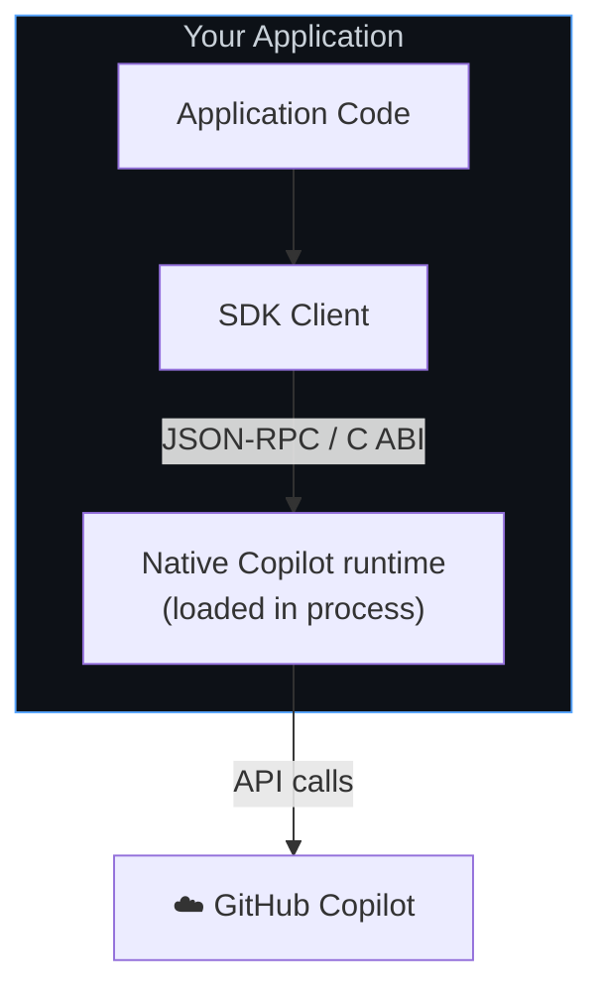
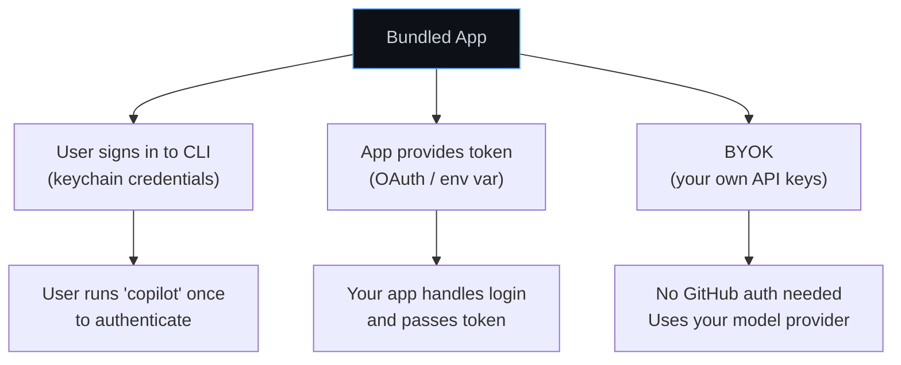

# Default setup (bundled runtime)

SDK v2 loads the native runtime into your application process by default. Node.js and .NET include platform runtime assets; Rust bundles them with its default features. Go applications use the bundler, and Java applications add a platform runtime classifier.

The Python SDK recommends a one-time download step after installation:

```bash
python -m copilot download-runtime --in-process
```

This downloads the matching runtime and caches it locally. If you skip this step, the SDK will attempt to download it automatically on first use as a fallback.

**Best for:** Most applications—desktop apps, standalone tools, CLI utilities, prototypes, and more.

## How it works

After the matching native artifacts are installed, the SDK loads the Rust runtime through its C ABI and communicates using framed JSON-RPC in memory. No separate CLI process or Node.js interpreter is needed. See [In-process runtime](./in-process-runtime.md) for platform requirements, shared-process limitations, and explicit subprocess alternatives.



**Key characteristics:**
* Platform-specific runtime assets are bundled or provisioned for the application
* The SDK pins the runtime version to ensure compatibility
* Users authenticate through your app (or use env vars / BYOK)
* Sessions are managed per-user on their machine

## Quick start

> [!NOTE]
> Each SDK has a minimum language runtime requirement—see the Prerequisites section of the [Node.js](../../nodejs/README.md#prerequisites), [Python](../../python/README.md#prerequisites), [Go](../../go/README.md#prerequisites), [Rust](../../rust/README.md#prerequisites), [Java](../../java/README.md#prerequisites), or [.NET](../../dotnet/README.md#prerequisites) README—since an unsupported runtime (e.g. Python below the stated floor) can cause `pip`/package managers to silently resolve an outdated SDK release instead of reporting a version conflict.

<details open>
<summary><strong>Node.js / TypeScript</strong></summary>

<!-- docs-validate: strict -->
```typescript
import { CopilotClient } from "@microsoft/copilot-sdk";

const client = new CopilotClient({ mode: "coding-agent" });

const session = await client.createSession({ model: "auto" });
const response = await session.sendAndWait({ prompt: "Hello!" });
console.log(response?.data.content);

await client.stop();
```

</details>

<details>
<summary><strong>Python</strong></summary>

```python
from copilot import CopilotClient
from copilot.session import PermissionHandler
from copilot.session_events import AssistantMessageData

client = CopilotClient(mode="coding-agent")
await client.start()

session = await client.create_session(
    model="auto", permissions={"on_request": PermissionHandler.approve_all}
)
response = await session.send_and_wait("Hello!")
if response and isinstance(response.data, AssistantMessageData):
    print(response.data.content)

await client.stop()
```

</details>

<details>
<summary><strong>Go</strong></summary>

> [!NOTE]
> The Go SDK needs a native runtime package. Run the [bundler tool](../../go/README.md#distributing-your-application-with-an-embedded-github-copilot-cli) before building, or set `COPILOT_CLI_PATH` to a compatible runtime package. No build tag is needed. The default does not search `PATH` or fall back to a subprocess.

<!-- docs-validate: hidden -->
```go
package main

import (
	"context"
	"fmt"
	copilot "github.com/microsoft/copilot-sdk/go/v2"
	"log"
)

func main() {
	ctx := context.Background()

	client := copilot.NewClient(&copilot.ClientOptions{Mode: copilot.ModeCodingAgent})
	if err := client.Start(ctx); err != nil {
		log.Fatal(err)
	}
	defer client.Stop()

	session, _ := client.CreateSession(ctx, &copilot.CreateSessionOptions{
		Model: "auto",
	})
	response, _ := session.SendAndWait(ctx, copilot.MessageOptions{
		Prompt: "Hello!",
	})
	if d, ok := response.Data.(*copilot.AssistantMessageData); ok {
		fmt.Println(d.Content)
	}
}
```
<!-- /docs-validate: hidden -->

```go
client := copilot.NewClient(&copilot.ClientOptions{Mode: copilot.ModeCodingAgent})
if err := client.Start(ctx); err != nil {
	log.Fatal(err)
}
defer client.Stop()

session, _ := client.CreateSession(ctx, &copilot.CreateSessionOptions{
	Model: "auto",
})
response, _ := session.SendAndWait(ctx, copilot.MessageOptions{
	Prompt: "Hello!",
})
if d, ok := response.Data.(*copilot.AssistantMessageData); ok {
	fmt.Println(d.Content)
}

```

</details>

<details>
<summary><strong>.NET</strong></summary>

```csharp
await using var client = new CopilotClient(new CopilotClientOptions { Mode = CopilotClientMode.CodingAgent });
await using var session = await client.CreateSessionAsync(new CreateSessionOptions
{
    Model = "auto"
});
var response = await session.SendAndWaitAsync(new MessageOptions
{
    Prompt = "Hello!"
});
Console.WriteLine(response?.Data.Content);
```

</details>

<details>
<summary><strong>Java</strong></summary>

> [!NOTE]
> Add the matching [platform runtime classifier](../../java/README.md#installation) alongside the Java SDK. JNA is included transitively. GraalVM native-image requires an explicit subprocess or external-server connection.

```java
import com.microsoft.copilot.CopilotClient;
import com.microsoft.copilot.rpc.*;

var client = new CopilotClient(new CopilotClientOptions().setMode(CopilotClientMode.CODING_AGENT));
client.start().get();

var session = client.createSession(new CreateSessionOptions()
    .setModel("auto")
    .setPermissions(new SessionPermissionOptions().setOnRequest(PermissionHandler.APPROVE_ALL))
).get();

var response = session.sendAndWait(new MessageOptions()
    .setPrompt("Hello!")).get();
System.out.println(response.getData().content());

client.stop().get();
```

</details>

## Authentication strategies

You need to decide how your users will authenticate. Here are the common patterns:



### Option A: user's signed-in credentials (simplest)

The user signs in to the CLI once, and your app uses those credentials. No extra code needed—this is the default behavior.

```typescript
import { CopilotClient } from "@microsoft/copilot-sdk";

const client = new CopilotClient({ mode: "coding-agent" });
// Default: uses signed-in user credentials
```

### Option B: token via environment variable

Ship your app with instructions to set a token, or set it programmatically:

```typescript
import { RuntimeConnection, CopilotClient } from "@microsoft/copilot-sdk";

// Your application's own way of getting the user's token
declare function getUserToken(): string;

const client = new CopilotClient({
    mode: "coding-agent",
    github: { token: getUserToken() },  // Your app provides the token
});
```

### Option C: BYOK (no GitHub auth needed)

If you manage your own model provider keys, users don't need GitHub accounts at all:

```typescript
import { CopilotClient } from "@microsoft/copilot-sdk";

const client = new CopilotClient({ mode: "coding-agent" });

const session = await client.createSession({
    model: "gpt-5.4",
    github: { capi: { enabled: false } },
    inference: {
        defaultProvider: "byok", providers: [{ name: "byok",
            type: "openai",
            baseUrl: "https://api.openai.com/v1",
            apiKey: process.env.OPENAI_API_KEY,
        }],
    },
});
```

See the **[BYOK guide](../auth/byok.md)** for full details.

## Session management

Apps typically want named sessions so users can resume conversations:

```typescript
import { CopilotClient } from "@microsoft/copilot-sdk";

// The project the user has open in your app
declare const projectName: string;

const client = new CopilotClient({ mode: "coding-agent" });

// Create a session tied to the user's project
const sessionId = `project-${projectName}`;
const session = await client.createSession({
    sessionId,
    model: "auto",
});

// User closes app...
// Later, resume where they left off
const resumed = await client.resumeSession(sessionId, {});
```

Session state persists at `~/.copilot/session-state/{sessionId}/`.

## When to move on

| Need | Next Guide |
|------|-----------|
| Users signing in with GitHub accounts | [GitHub OAuth](./github-oauth.md) |
| Run on a server instead of user machines | [Backend Services](./backend-services.md) |
| Use your own model keys | [BYOK](../auth/byok.md) |

## Next steps

* **[BYOK guide](../auth/byok.md)**: Use your own model provider keys
* **[Session Persistence](../features/session-persistence.md)**: Advanced session management
* **[Getting Started tutorial](../getting-started.md)**: Build a complete app
