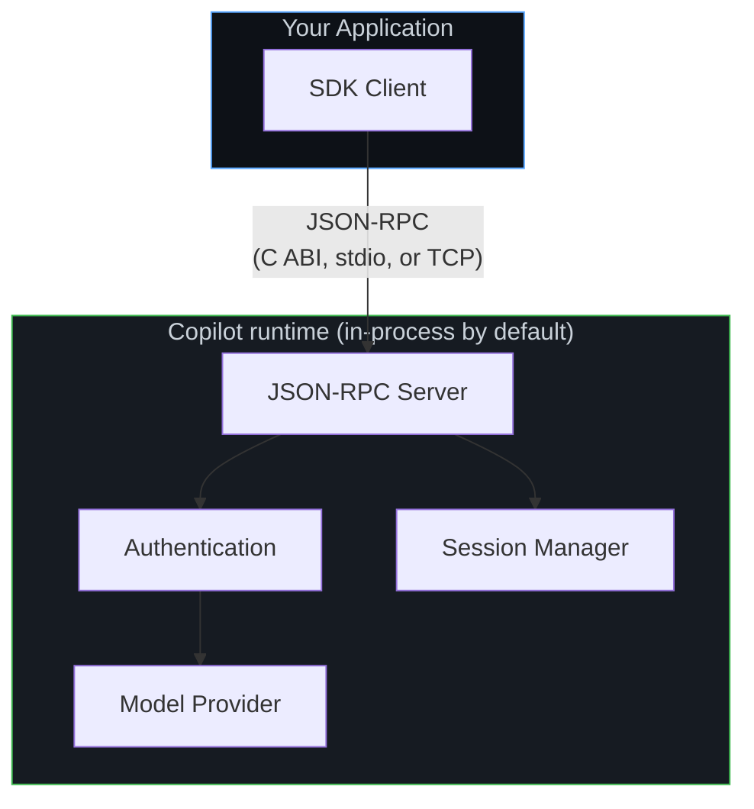
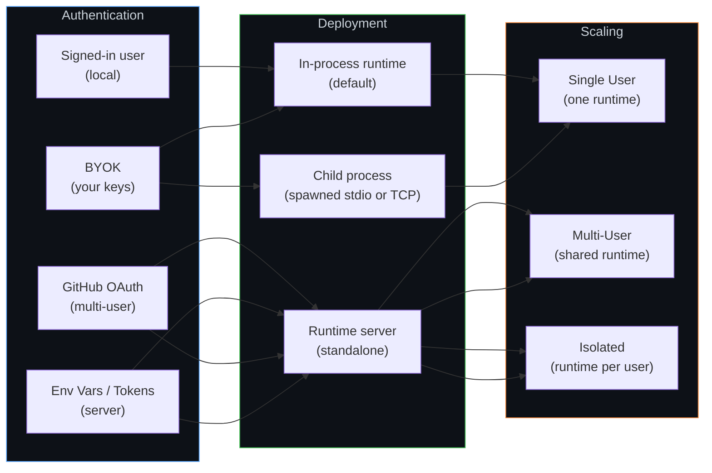

# Setup guides

These guides walk you through configuring the Copilot SDK for your specific use case—from personal side projects to production platforms serving thousands of users.

## Architecture at a glance

Every Copilot SDK integration uses JSON-RPC to reach the Copilot runtime. The runtime is a standalone, multi-tenant component, separate from the GitHub Copilot CLI, so your application doesn't need the CLI installed. SDK v2 hosts the runtime in process by default; explicit child-process and standalone-server connections are also available. Setups differ in **where the runtime runs**, **how users authenticate**, and **how sessions are managed**.

You can host the runtime in three ways:

* **In process (default)**: the SDK loads the native runtime library into your application process and exchanges JSON-RPC messages with it in memory, with no child process, TCP port, or connection token. In-process hosting is not a sandbox and provides no crash isolation. See [Default setup (bundled runtime)](./bundled-cli.md) and [In-process runtime](./in-process-runtime.md).
* **SDK-managed child process**: select a spawned connection, such as `RuntimeConnection.forSpawnedStdio()` or `RuntimeConnection.forSpawnedTcp()` (TypeScript and Java names; each SDK has an equivalent), and the SDK starts the runtime as a child process and talks to it over stdio or TCP. Choose this when you need crash isolation or per-client process configuration such as the executable path, arguments, environment, or working directory. See [Migrate to the v2 default](./in-process-runtime.md#migrate-to-the-v2-default) and [Use your own runtime binary](./local-cli.md).
* **Standalone runtime server**: you run `copilot-runtime --server` yourself, and the SDK attaches to it over TCP with `RuntimeConnection.forTcp(host, port)`. One runtime server can serve many SDK clients and concurrent sessions. See [Backend services](./backend-services.md) and [Multi-tenancy and server deployments](./multi-tenancy.md).

The setup guides below help you configure each layer for your scenario.

## Who are you?

### 🧑‍💻 Hobbyist

You're building a personal assistant, side project, or experimental app. You want the simplest path to getting Copilot in your code.

**Start with:**
1. **[Default setup (bundled runtime)](./bundled-cli.md)**—Provision the platform runtime and host it in process
1. **[Use your own runtime binary](./local-cli.md)**—Run a runtime executable you supply as a child process (advanced)

### 🏢 Internal app developer

You're building tools for your team or company. Users are employees who need to authenticate with their enterprise GitHub accounts or org memberships.

**Start with:**
1. **[GitHub OAuth](./github-oauth.md)**—Let employees sign in with their GitHub accounts
1. **[Backend Services](./backend-services.md)**—Run the SDK in your internal services

**If scaling beyond a single server:**
1. **[Multi-tenancy and server deployments](./multi-tenancy.md)**—Configure SDK options for multi-user server deployments
1. **[Scaling & Multi-Tenancy](./scaling.md)**—Handle multiple users and services

### 🚀 App developer (ISV)

You're building a product for customers. You need to handle authentication for your users—either through GitHub or by managing identity yourself.

**Start with:**
1. **[GitHub OAuth](./github-oauth.md)**—Let customers sign in with GitHub
1. **[BYOK](../auth/byok.md)**—Manage identity yourself with your own model keys
1. **[Backend Services](./backend-services.md)**—Power your product from server-side code

**For production:**
1. **[Multi-tenancy and server deployments](./multi-tenancy.md)**—Use `mode: "empty"`, per-session tokens, and isolated runtime state
1. **[Scaling & Multi-Tenancy](./scaling.md)**—Serve many customers reliably

### 🏗️ Platform developer

You're embedding Copilot into a platform—APIs, developer tools, or infrastructure that other developers build on. You need fine-grained control over sessions, scaling, and multi-tenancy.

**Start with:**
1. **[Backend Services](./backend-services.md)**—Core server-side integration
1. **[Multi-tenancy and server deployments](./multi-tenancy.md)**—SDK-level isolation, per-session auth, and shared runtime options
1. **[Scaling & Multi-Tenancy](./scaling.md)**—Session isolation, horizontal scaling, persistence

**Depending on your auth model:**
1. **[GitHub OAuth](./github-oauth.md)**—For GitHub-authenticated users
1. **[BYOK](../auth/byok.md)**—For self-managed identity and model access

## Decision matrix

Use this table to find the right guides based on what you need to do:

| What you need | Guide |
|---------------|-------|
| Getting started quickly | [Default setup (bundled runtime)](./bundled-cli.md) |
| Use your own runtime binary | [Use your own runtime binary](./local-cli.md) |
| Users sign in with GitHub | [GitHub OAuth](./github-oauth.md) |
| Use your own model keys (OpenAI, Azure, and more) | [BYOK](../auth/byok.md) |
| Azure BYOK with Managed Identity (no API keys) | [Azure Managed Identity](./azure-managed-identity.md) |
| Run the SDK on a server | [Backend Services](./backend-services.md) |
| Connect to a runtime server you run yourself | [Connecting to a standalone runtime server](../getting-started.md#connecting-to-a-standalone-runtime-server), [Backend Services](./backend-services.md) |
| Understand the in-process default or retain subprocess isolation | [In-process runtime](./in-process-runtime.md) |
| Configure SDK options for concurrent users | [Multi-tenancy and server deployments](./multi-tenancy.md) |
| Serve multiple users / scale horizontally | [Scaling & Multi-Tenancy](./scaling.md) |

## Configuration comparison

## Prerequisites

All guides assume you have:

* **One of the SDKs** installed with its matching native runtime (you don't install the GitHub Copilot CLI):
  * Node.js: `npm install @microsoft/copilot-sdk`
  * Python: `pip install microsoft-copilot-sdk`
  * Go: `go get github.com/microsoft/copilot-sdk/go/v2`, then run the [application bundler](../../go/README.md#distributing-your-application-with-an-embedded-github-copilot-cli)
  * .NET: `dotnet add package Microsoft.Copilot.SDK`
  * Rust: `cargo add copilot-sdk`
  * Java: `com.microsoft:copilot-sdk` with [Maven](../../java/README.md#maven) or [Gradle](../../java/README.md#gradle), plus the matching `com.microsoft:copilot-sdk-runtime` classifier

If you're brand new, start with the **[Getting Started tutorial](../getting-started.md)** first, then come back here for production configuration.

## Next steps

Pick the guide that matches your situation from the [decision matrix](#decision-matrix) above, or start with the persona description closest to your role.
