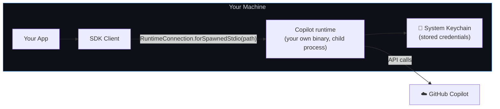

# Use your own runtime binary

Run a specific Copilot runtime executable in a child process instead of the runtime that the SDK hosts in your application's process by default. This is an advanced option—you supply the path to `copilot-runtime` explicitly, and you are responsible for ensuring version compatibility with the SDK.

**Use when:** You need an explicit child process that runs a specific, compatible runtime version.

## How it works

SDK v2 defaults to [in-process native hosting](./bundled-cli.md), so this setup is an explicit opt-in: select a spawned stdio connection and give it the path to your executable. The samples below show TypeScript (`RuntimeConnection.forSpawnedStdio({ path })`), Python, Go, and .NET; in Java use `RuntimeConnection.forSpawnedStdio(path)`, and in Rust pass `SpawnedProcessOptions::new().with_program(...)` to `RuntimeConnection::for_spawned_stdio`. The SDK starts the runtime as a child process, communicates with it over stdio, and stops it when the client stops.

Get `copilot-runtime` from a `github-copilot-<version>-<platform>.tgz` asset on the [GitHub Copilot CLI releases](https://github.com/github/copilot-cli/releases) page (inside the archive it's `package/prebuilds/<platform>/copilot-runtime`). Extract the whole package, keep its layout intact, and point the SDK at the executable inside it: the executable loads `runtime.node` from its own directory, and the runtime finds its built-in agents, skills and search tools in the package root. The examples below assume a Linux x64 package extracted to `/opt/copilot`:

```bash
mkdir -p /opt/copilot
tar -xzf github-copilot-<version>-linux-x64.tgz -C /opt/copilot --strip-components=1
```



**Key characteristics:**

- You explicitly provide the runtime executable path
- The runtime runs in a separate child process that the SDK starts and stops
- You are responsible for runtime version compatibility with the SDK
- Authentication uses the signed-in user's credentials from the system keychain (or env vars)
- Communication happens over stdio

## Configuration

### Using a local runtime binary

<details open>
<summary><strong>Node.js / TypeScript</strong></summary>

<!-- docs-validate: strict -->

```typescript
import { CopilotClient, RuntimeConnection } from "@microsoft/copilot-sdk";

const client = new CopilotClient({
    mode: "coding-agent",
    runtime: RuntimeConnection.forSpawnedStdio({ path: "/opt/copilot/prebuilds/linux-x64/copilot-runtime" }),
});

const session = await client.createSession({ model: "auto" });
const response = await session.sendAndWait({ prompt: "Hello!" });
console.log(response?.data.content);

await client.stop();
```

</details>

<details>
<summary><strong>Python</strong></summary>

```python
from copilot import CopilotClient, RuntimeConnection
from copilot.session_events import AssistantMessageData
from copilot.session import PermissionHandler

client = CopilotClient(
    mode="coding-agent",
    runtime=RuntimeConnection.for_spawned_stdio(path="/opt/copilot/prebuilds/linux-x64/copilot-runtime"),
)
await client.start()

session = await client.create_session(
    model="auto", permissions={"on_request": PermissionHandler.approve_all}
)
response = await session.send_and_wait("Hello!")
if response:
    match response.data:
        case AssistantMessageData() as data:
            print(data.content)

await client.stop()
```

</details>

<details>
<summary><strong>Go</strong></summary>

> [!NOTE]
> The Go SDK does not ship runtime assets automatically. Use the [bundler tool](../../go/README.md#distributing-your-application-with-an-embedded-github-copilot-cli), or point `SpawnedStdioConnection.Path` at a compatible `copilot-runtime` executable as shown here.

<!-- docs-validate: hidden -->

```go
package main

import (
	"context"
	"fmt"
	copilot "github.com/microsoft/copilot-sdk/go/v2"
	"log"
)

func main() {
	ctx := context.Background()

	client := copilot.NewClient(&copilot.ClientOptions{
		Mode: copilot.ModeCodingAgent,
		Runtime: copilot.SpawnedStdioConnection{Path: "/opt/copilot/prebuilds/linux-x64/copilot-runtime"},
	})
	if err := client.Start(ctx); err != nil {
		log.Fatal(err)
	}
	defer client.Stop()

	session, _ := client.CreateSession(ctx, &copilot.CreateSessionOptions{
		Model: "auto",
	})
	response, _ := session.SendAndWait(ctx, copilot.MessageOptions{
		Prompt: "Hello!",
	})
	if response != nil {
		if d, ok := response.Data.(*copilot.AssistantMessageData); ok {
			fmt.Println(d.Content)
		}
	}
}
```

<!-- /docs-validate: hidden -->

```go
client := copilot.NewClient(&copilot.ClientOptions{
    Mode: copilot.ModeCodingAgent,
    Runtime: copilot.SpawnedStdioConnection{Path: "/opt/copilot/prebuilds/linux-x64/copilot-runtime"},
})
if err := client.Start(ctx); err != nil {
	log.Fatal(err)
}
defer client.Stop()

session, _ := client.CreateSession(ctx, &copilot.CreateSessionOptions{
	Model: "auto",
})
response, _ := session.SendAndWait(ctx, copilot.MessageOptions{
	Prompt: "Hello!",
})
if response != nil {
	if d, ok := response.Data.(*copilot.AssistantMessageData); ok {
		fmt.Println(d.Content)
	}
}

```

</details>

<details>
<summary><strong>.NET</strong></summary>

```csharp
var client = new CopilotClient(new CopilotClientOptions
{
    Mode = CopilotClientMode.CodingAgent,
    Runtime = RuntimeConnection.ForSpawnedStdio(path: "/opt/copilot/prebuilds/linux-x64/copilot-runtime")
});
await using var session = await client.CreateSessionAsync(new CreateSessionOptions
{
    Model = "auto"
});
var response = await session.SendAndWaitAsync(new MessageOptions
{
    Prompt = "Hello!"
});
Console.WriteLine(response?.Data.Content);
```

</details>

## Additional options

```typescript
import { CopilotClient, RuntimeConnection } from "@microsoft/copilot-sdk";

const client = new CopilotClient({
    mode: "coding-agent",
    runtime: RuntimeConnection.forSpawnedStdio({
        path: "/opt/copilot/prebuilds/linux-x64/copilot-runtime",

        // Pass extra runtime arguments
        args: ["--log-dir=/tmp/copilot-logs"],

        // Set the spawned process working directory
        workingDirectory: "/path/to/project",
    }),
    observability: {
        logLevel: "debug",
    },
});
```

## Using environment variables

Instead of the keychain, you can authenticate via environment variables. This is useful for CI or when you don't want interactive login.

```bash
# Set one of these (in priority order):
export COPILOT_GITHUB_TOKEN="gho_xxxx"   # Recommended
export GH_TOKEN="gho_xxxx"               # GitHub CLI compatible
export GITHUB_TOKEN="gho_xxxx"           # GitHub Actions compatible
```

The SDK picks these up automatically—no code changes needed.

## Managing sessions

A session is saved to disk once it handles a message and can be resumed by its ID. To choose the ID instead of using the generated one, provide your own session ID:

<!-- docs-validate: strict -->

```typescript
// Create a named session
const session = await client.createSession({
    sessionId: "my-project-analysis",
    model: "auto",
});

// Later, resume it
const resumed = await client.resumeSession("my-project-analysis", {});
```

Session state is stored locally at `~/.copilot/session-state/{sessionId}/`.

## Limitations

| Limitation                                   | Details                                                                                                                                                                                                                 |
| -------------------------------------------- | ----------------------------------------------------------------------------------------------------------------------------------------------------------------------------------------------------------------------- |
| **Version compatibility**                    | You must ensure your runtime version is compatible with the SDK                                                                                                                                                         |
| **Signed-in credentials belong to one user** | Keychain credentials are tied to whoever signed in on that machine. To serve several users, pass a GitHub token per session or use BYOK; see [Multi-tenancy and server deployments](./multi-tenancy.md)                 |
| **Local child process**                      | The SDK starts the runtime on the same machine as your app. To share one runtime across machines or clients, run a [standalone runtime server](../getting-started.md#connecting-to-a-standalone-runtime-server) instead |

## Next steps

- **[Default setup (bundled runtime)](./bundled-cli.md)**: Host the runtime the SDK provides in your application's process (recommended for most use cases)
- **[Getting Started tutorial](../getting-started.md)**: Build a complete interactive app
- **[Authentication docs](../auth/authenticate.md)**: All auth methods in detail
