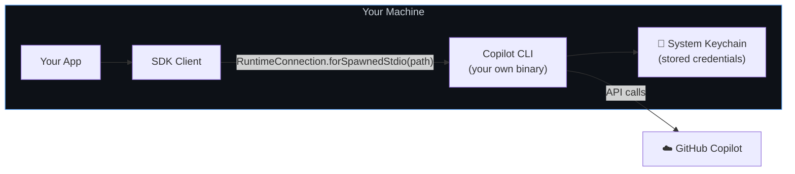

# Local CLI setup

Use a specific CLI binary instead of the SDK's automatic CLI management. This is an advanced option—you supply the CLI path explicitly, and you are responsible for ensuring version compatibility with the SDK.

**Use when:** You need an explicit subprocess using a specific compatible CLI version.

## How it works

SDK v2 defaults to [in-process native hosting](./bundled-cli.md). To use a system-installed CLI in a subprocess instead, select a stdio `Connection` explicitly.



**Key characteristics:**

- You explicitly provide the CLI binary path
- You are responsible for CLI version compatibility with the SDK
- Authentication uses the signed-in user's credentials from the system keychain (or env vars)
- Communication happens over stdio

## Configuration

### Using a local CLI binary

<details open>
<summary><strong>Node.js / TypeScript</strong></summary>

<!-- docs-validate: strict -->

```typescript
import { CopilotClient, RuntimeConnection } from "@microsoft/copilot-sdk";

const client = new CopilotClient({
    mode: "coding-agent",
    runtime: RuntimeConnection.forSpawnedStdio({ path: "/usr/local/bin/copilot" }),
});

const session = await client.createSession({ model: "auto" });
const response = await session.sendAndWait({ prompt: "Hello!" });
console.log(response?.data.content);

await client.stop();
```

</details>

<details>
<summary><strong>Python</strong></summary>

```python
from copilot import CopilotClient, RuntimeConnection
from copilot.session_events import AssistantMessageData
from copilot.session import PermissionHandler

client = CopilotClient(
    mode="coding-agent",
    runtime=RuntimeConnection.for_spawned_stdio(path="/usr/local/bin/copilot"),
)
await client.start()

session = await client.create_session(
    model="auto", permissions={"on_request": PermissionHandler.approve_all}
)
response = await session.send_and_wait("Hello!")
if response:
    match response.data:
        case AssistantMessageData() as data:
            print(data.content)

await client.stop()
```

</details>

<details>
<summary><strong>Go</strong></summary>

> [!NOTE]
> The Go SDK does not ship runtime assets automatically. Use the [bundler tool](../../go/README.md#distributing-your-application-with-an-embedded-github-copilot-cli), or point `SpawnedStdioConnection.Path` at an installed compatible binary as shown here.

<!-- docs-validate: hidden -->

```go
package main

import (
	"context"
	"fmt"
	copilot "github.com/microsoft/copilot-sdk/go/v2"
	"log"
)

func main() {
	ctx := context.Background()

	client := copilot.NewClient(&copilot.ClientOptions{
		Mode: copilot.ModeCodingAgent,
		Runtime: copilot.SpawnedStdioConnection{Path: "/usr/local/bin/copilot"},
	})
	if err := client.Start(ctx); err != nil {
		log.Fatal(err)
	}
	defer client.Stop()

	session, _ := client.CreateSession(ctx, &copilot.CreateSessionOptions{
		Model: "auto",
	})
	response, _ := session.SendAndWait(ctx, copilot.MessageOptions{
		Prompt: "Hello!",
	})
	if response != nil {
		if d, ok := response.Data.(*copilot.AssistantMessageData); ok {
			fmt.Println(d.Content)
		}
	}
}
```

<!-- /docs-validate: hidden -->

```go
client := copilot.NewClient(&copilot.ClientOptions{
    Mode: copilot.ModeCodingAgent,
    Runtime: copilot.SpawnedStdioConnection{Path: "/usr/local/bin/copilot"},
})
if err := client.Start(ctx); err != nil {
	log.Fatal(err)
}
defer client.Stop()

session, _ := client.CreateSession(ctx, &copilot.CreateSessionOptions{
	Model: "auto",
})
response, _ := session.SendAndWait(ctx, copilot.MessageOptions{
	Prompt: "Hello!",
})
if response != nil {
	if d, ok := response.Data.(*copilot.AssistantMessageData); ok {
		fmt.Println(d.Content)
	}
}

```

</details>

<details>
<summary><strong>.NET</strong></summary>

```csharp
var client = new CopilotClient(new CopilotClientOptions
{
    Mode = CopilotClientMode.CodingAgent,
    Runtime = RuntimeConnection.ForSpawnedStdio(path: "/usr/local/bin/copilot")
});
await using var session = await client.CreateSessionAsync(new CreateSessionOptions
{
    Model = "auto"
});
var response = await session.SendAndWaitAsync(new MessageOptions
{
    Prompt = "Hello!"
});
Console.WriteLine(response?.Data.Content);
```

</details>

## Additional options

```typescript
import { CopilotClient, RuntimeConnection } from "@microsoft/copilot-sdk";

const client = new CopilotClient({
    mode: "coding-agent",
    runtime: RuntimeConnection.forSpawnedStdio({
        path: "/usr/local/bin/copilot",

        // Pass extra CLI arguments
        args: ["--log-dir=/tmp/copilot-logs"],

        // Set the spawned process working directory
        workingDirectory: "/path/to/project",
    }),
    observability: {
        logLevel: "debug",
    },
});
```

## Using environment variables

Instead of the keychain, you can authenticate via environment variables. This is useful for CI or when you don't want interactive login.

```bash
# Set one of these (in priority order):
export COPILOT_GITHUB_TOKEN="gho_xxxx"   # Recommended
export GH_TOKEN="gho_xxxx"               # GitHub CLI compatible
export GITHUB_TOKEN="gho_xxxx"           # GitHub Actions compatible
```

The SDK picks these up automatically—no code changes needed.

## Managing sessions

A session is saved to disk once it handles a message and can be resumed by its ID. To choose the ID instead of using the generated one, provide your own session ID:

<!-- docs-validate: strict -->

```typescript
// Create a named session
const session = await client.createSession({
    sessionId: "my-project-analysis",
    model: "auto",
});

// Later, resume it
const resumed = await client.resumeSession("my-project-analysis", {});
```

Session state is stored locally at `~/.copilot/session-state/{sessionId}/`.

## Limitations

| Limitation                | Details                                                     |
| ------------------------- | ----------------------------------------------------------- |
| **Version compatibility** | You must ensure your CLI version is compatible with the SDK |
| **Single user**           | Credentials are tied to whoever signed in to the CLI        |
| **Local only**            | The CLI runs on the same machine as your app                |
| **No multi-tenant**       | Can't serve multiple users from one CLI instance            |

## Next steps

- **[Default Setup](./bundled-cli.md)**: Use the SDK's built-in CLI (recommended for most use cases)
- **[Getting Started tutorial](../getting-started.md)**: Build a complete interactive app
- **[Authentication docs](../auth/authenticate.md)**: All auth methods in detail
