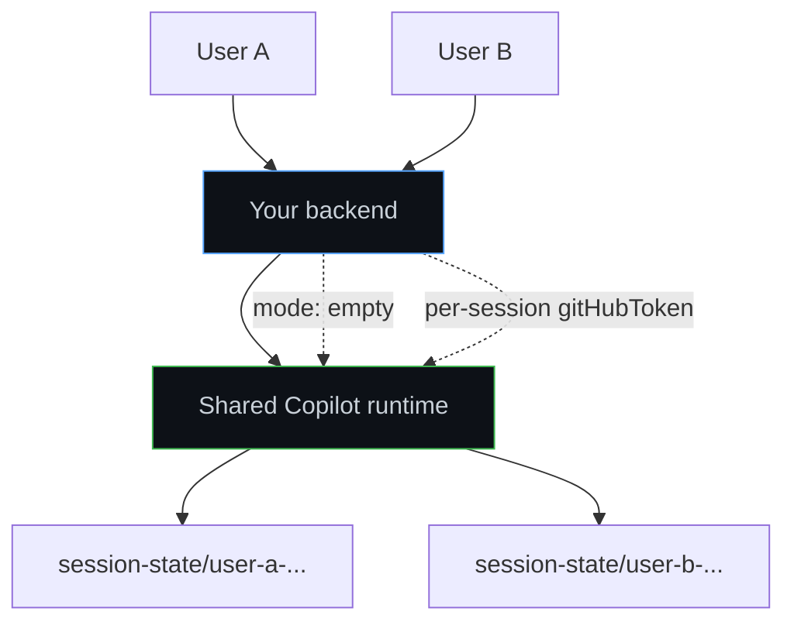

# Multi-tenancy and server deployments

Multi-user server mode means running the Copilot SDK from backend code that serves more than one human, tenant, workspace, or integration account. In this setup, the application owns request routing and authorization, while the SDK and runtime provide per-session state, per-session authentication, and explicit tool registration so one user's session does not inherit another user's tools or identity.

**Best for:** SaaS products, partner integrations, internal platforms, and backend services that handle concurrent users.

## Use this guide when

Use this guide when you are building:

- A multi-user SaaS product that embeds Copilot-powered agents
- A backend for a partner integration, such as a Copilot Studio or Fabric-style pattern
- Any server that handles concurrent users, workspaces, tenants, or requests
- A shared runtime where multiple SDK clients connect to one Copilot runtime process

This guide is a sister to [Scaling and multi-tenancy](./scaling.md). Use that guide for topology, load-balancing, and storage patterns. Use this guide for SDK-level options and runtime isolation choices.

## Key SDK options

| Option                                          | Use it for                                        | Notes                                                                                                                  |
| ----------------------------------------------- | ------------------------------------------------- | ---------------------------------------------------------------------------------------------------------------------- |
| `mode: "empty"`                                 | Disabling ambient OS tools and CLI defaults       | Required for multi-user or shared scenarios.                                                                           |
| `OwnedRuntimeOptions.sessionIdleTimeoutSeconds` | Cleaning idle sessions                            | On a runtime server, pass `--session-idle-timeout` instead.                                                            |
| `OwnedRuntimeOptions.baseDirectory`             | Isolating `COPILOT_HOME` per owned runtime        | On a runtime server, set `COPILOT_HOME` or pass `--config-dir` instead.                                                |
| `sessionFs`                                     | Routing session filesystem storage off local disk | Pair with per-session filesystem providers.                                                                            |
| `RuntimeConnection.forTcp(host, port)`          | Sharing one already-running runtime               | Language names vary; see samples below.                                                                                |
| `state.memory.storeMemory`                      | Keeping agent memories in application storage     | Your app owns storage, isolation and recall.                                                                           |
| Per-session GitHub token or provider            | Scoping auth to the requesting user               | Prefer a rotating provider for short-lived credentials; use a static `github.token` only when rotation is unnecessary. |

For callback-backed credentials, see [Rotating session-scoped GitHub tokens](../auth/authenticate.md#rotating-session-scoped-github-tokens). Each session owns its provider registration, so concurrent sessions can use different GitHub hosts and accounts without sharing callback state.

### `mode: "empty"`

`mode: "empty"` disables the optional CLI-style behavior of `mode: "coding-agent"` by default. In multi-user server mode, this is the safe baseline because your application must explicitly decide which tools, MCP servers, skills, and workspace paths a session can access.

Do not use `mode: "coding-agent"` for shared servers. That mode is intended for CLI-like coding agents and can expose ambient host filesystem capabilities.

<details open>
<summary><strong>TypeScript</strong></summary>

<!-- docs-validate: hidden -->

```typescript
import { CopilotClient, RuntimeConnection } from "@microsoft/copilot-sdk";

// Provided by your auth layer
declare const user: { id: string; githubToken: string };

// baseDirectory and sessionIdleTimeoutSeconds apply to SDK-owned
// runtime. With RuntimeConnection.forTcp(...) configure COPILOT_HOME and the
// idle timeout on the runtime process itself.
const client = new CopilotClient({
    mode: "empty",
    runtime: RuntimeConnection.forTcp(process.env.COPILOT_RUNTIME_HOST!, Number(process.env.COPILOT_RUNTIME_PORT!)),
});

const session = await client.createSession({
    sessionId: `user-${user.id}-${crypto.randomUUID()}`,
    model: "auto",
    tools: {
        availableTools: ["custom:lookupOrder", "custom:createTicket"],
    },
    github: {
        token: user.githubToken,
    },
});
```

<!-- /docs-validate: hidden -->

```typescript
import { CopilotClient, RuntimeConnection } from "@microsoft/copilot-sdk";

// baseDirectory and sessionIdleTimeoutSeconds apply to SDK-owned
// runtime. With RuntimeConnection.forTcp(...) configure COPILOT_HOME and the
// idle timeout on the runtime process itself.
const client = new CopilotClient({
    mode: "empty",
    runtime: RuntimeConnection.forTcp(process.env.COPILOT_RUNTIME_HOST!, Number(process.env.COPILOT_RUNTIME_PORT!)),
});

const session = await client.createSession({
    sessionId: `user-${user.id}-${crypto.randomUUID()}`,
    model: "auto",
    tools: {
        availableTools: ["custom:lookupOrder", "custom:createTicket"],
    },
    github: {
        token: user.githubToken,
    },
});
```

</details>

<details>
<summary><strong>Python</strong></summary>

```python
import os
from types import SimpleNamespace
from copilot import CopilotClient, RuntimeConnection
from copilot.session import PermissionHandler

runtime_host, runtime_port = "localhost", 4321
request_id = "request-456"
user = SimpleNamespace(id="123", github_token=os.environ["GITHUB_TOKEN"])

client = CopilotClient(
    mode="empty",
    runtime=RuntimeConnection.for_tcp(runtime_host, runtime_port),
)
await client.start()

session = await client.create_session(
    session_id=f"user-{user.id}-{request_id}",
    model="auto",
    tools={"available_tools": ["custom:lookupOrder", "custom:createTicket"]},
    github={"token": user.github_token},
    permissions={"on_request": PermissionHandler.approve_all},
)
```

</details>

<details>
<summary><strong>Go</strong></summary>

<!-- docs-validate: hidden -->

```go
package main

import (
	"context"
	"fmt"

	copilot "github.com/microsoft/copilot-sdk/go/v2"
)

type appUser struct {
	ID          string
	GitHubToken string
}

func main() {
	ctx := context.Background()
	runtimeHost, runtimePort := "127.0.0.1", 8080
	requestID := "req-1"
	user := appUser{ID: "alice", GitHubToken: "gho_xxx"}

    client := copilot.NewClient(&copilot.ClientOptions{
        Mode:                      copilot.ModeEmpty,
        Runtime:                copilot.TCPConnection{Host: runtimeHost, Port: runtimePort},
    })

	session, err := client.CreateSession(ctx, &copilot.CreateSessionOptions{
		SessionID: fmt.Sprintf("user-%s-%s", user.ID, requestID),
		Model:     "auto",
		Tools: copilot.SessionToolOptions{
			AvailableTools: []string{"custom:lookupOrder", "custom:createTicket"},
		},
		GitHub: copilot.SessionGitHubOptions{
			Token: user.GitHubToken,
		},
	})
	_ = session
	_ = err
}
```

<!-- /docs-validate: hidden -->

```go
client := copilot.NewClient(&copilot.ClientOptions{
    Mode:                      copilot.ModeEmpty,
    Runtime:                copilot.TCPConnection{Host: runtimeHost, Port: runtimePort},
})

session, err := client.CreateSession(ctx, &copilot.CreateSessionOptions{
	SessionID: fmt.Sprintf("user-%s-%s", user.ID, requestID),
	Model:     "auto",
	Tools: copilot.SessionToolOptions{
		AvailableTools: []string{"custom:lookupOrder", "custom:createTicket"},
	},
	GitHub: copilot.SessionGitHubOptions{
		Token: user.GitHubToken,
	},
})

```

</details>

<details>
<summary><strong>.NET</strong></summary>

<!-- docs-validate: hidden -->

```csharp
using Microsoft.Copilot;

var runtimeHost = "127.0.0.1"; var runtimePort = 8080;
var requestId = "req-1";
var user = new
{
    Id = "alice",
    GitHubToken = "gho_xxx"
};
var client = new CopilotClient(new CopilotClientOptions
{
    Mode = CopilotClientMode.Empty,
    Runtime = RuntimeConnection.ForTcp(runtimeHost, runtimePort),
});
await using var session = await client.CreateSessionAsync(new CreateSessionOptions
{
    SessionId = $"user-{user.Id}-{requestId}",
    Model = "auto",
    Tools = new SessionToolOptions
    {
        AvailableTools = ["custom:lookupOrder", "custom:createTicket"],
    },
    GitHub = new SessionGitHubOptions
    {
        Token = user.GitHubToken
    },
});
```

<!-- /docs-validate: hidden -->

```csharp
var client = new CopilotClient(new CopilotClientOptions
{
    Mode = CopilotClientMode.Empty,
    Runtime = RuntimeConnection.ForTcp(runtimeHost, runtimePort),
});
await using var session = await client.CreateSessionAsync(new CreateSessionOptions
{
    SessionId = $"user-{user.Id}-{requestId}",
    Model = "auto",
    Tools = new SessionToolOptions
    {
        AvailableTools = ["custom:lookupOrder", "custom:createTicket"],
    },
    GitHub = new SessionGitHubOptions
    {
        Token = user.GitHubToken
    },
});
```

</details>

<details>
<summary><strong>Java</strong></summary>

<!-- docs-validate: hidden -->

```java
import java.util.List;
import com.microsoft.copilot.CopilotClient;
import com.microsoft.copilot.rpc.CopilotClientOptions;
import com.microsoft.copilot.rpc.CopilotClientMode;
import com.microsoft.copilot.rpc.CreateSessionOptions;
import com.microsoft.copilot.rpc.RuntimeConnection;
import com.microsoft.copilot.rpc.SessionGitHubOptions;
import com.microsoft.copilot.rpc.SessionToolOptions;

public class MultiTenancyExample {
    record User(String id, String gitHubToken) {
    }

    public static void main(String[] args) throws Exception {
        String runtimeHost = "localhost"; int runtimePort = 4321;
        String requestId = "req-1";
        User user = new User("u1", "ghu_token");

        // Configure data storage and idle timeout on the external runtime;
        // Attached TCP connections do not own these settings.
        var client = new CopilotClient(new CopilotClientOptions()
                .setMode(CopilotClientMode.EMPTY)
                .setRuntime(RuntimeConnection
                        .forTcp(runtimeHost, runtimePort)));

        var session = client
                .createSession(new CreateSessionOptions()
                        .setSessionId("user-" + user
                                .id() + "-" + requestId)
                        .setModel("auto")
                        .setTools(new SessionToolOptions()
                                .setAvailableTools(List
                                        .of("custom:lookupOrder", "custom:createTicket")))
                        .setGitHub(new SessionGitHubOptions()
                                .setToken(user
                                        .gitHubToken())))
                .get();
    }
}
```

<!-- /docs-validate: hidden -->

```java
// Configure data storage and idle timeout on the external runtime;
// Attached TCP connections do not own these settings.
var client = new CopilotClient(new CopilotClientOptions()
        .setMode(CopilotClientMode.EMPTY)
        .setRuntime(RuntimeConnection
                .forTcp(runtimeHost, runtimePort)));

var session = client
        .createSession(new CreateSessionOptions()
                .setSessionId("user-" + user
                        .id() + "-" + requestId)
                .setModel("auto")
                .setTools(new SessionToolOptions()
                        .setAvailableTools(List
                                .of("custom:lookupOrder", "custom:createTicket")))
                .setGitHub(new SessionGitHubOptions()
                        .setToken(user
                                .gitHubToken())))
        .get();
```

</details>

<details>
<summary><strong>Rust</strong></summary>

<!-- docs-validate: hidden -->

```rust
struct User {
    id: String,
    github_token: String,
}
let runtime_host = "127.0.0.1";
let runtime_port: u16 = 3000;
let request_id = "request-1";
let user = User {
    id: "user-1".into(),
    github_token: String::new(),
};

use copilot_sdk::{Client, ClientOptions, RuntimeConnection};
use copilot_sdk::mode::ClientMode;
use copilot_sdk::types::CreateSessionOptions;

let client = Client::start(
    ClientOptions::new(ClientMode::Empty)
        .with_runtime(RuntimeConnection::for_tcp(runtime_host, runtime_port)),
)
.await?;

let session = client
    .create_session(
        CreateSessionOptions::default()
            .with_session_id(format!("user-{}-{request_id}", user.id))
            .with_model("auto")
            .with_tools(|__sdk_group| {
                __sdk_group.with_available_tools(["custom:lookupOrder", "custom:createTicket"])
            })
            .with_github(|__sdk_group| __sdk_group.with_token(user.github_token)),
    )
    .await?;
```

<!-- /docs-validate: hidden -->

```rust
use copilot_sdk::{Client, ClientOptions, RuntimeConnection};
use copilot_sdk::mode::ClientMode;
use copilot_sdk::types::CreateSessionOptions;

let client = Client::start(
    ClientOptions::new(ClientMode::Empty)
        .with_runtime(RuntimeConnection::for_tcp(runtime_host, runtime_port)),
)
.await?;

let session = client
    .create_session(
        CreateSessionOptions::default()
            .with_session_id(format!("user-{}-{request_id}", user.id))
            .with_model("auto")
            .with_tools(|__sdk_group| {
                __sdk_group.with_available_tools(["custom:lookupOrder", "custom:createTicket"])
            })
            .with_github(|__sdk_group| __sdk_group.with_token(user.github_token)),
    )
    .await?;
```

</details>

### `sessionIdleTimeoutSeconds`

Set `sessionIdleTimeoutSeconds` in owned-runtime options to clean up inactive sessions and reduce memory and filesystem pressure. A client attached to a runtime server can't set it; pass `--session-idle-timeout <seconds>` when you start the server instead.

| Language   | Public option                            |
| ---------- | ---------------------------------------- |
| TypeScript | `sessionIdleTimeoutSeconds`              |
| Python     | `session_idle_timeout_seconds`           |
| Go         | `SessionIdleTimeoutSeconds`              |
| .NET       | `SessionIdleTimeoutSeconds`              |
| Java       | `setSessionIdleTimeoutSeconds(...)`      |
| Rust       | `with_session_idle_timeout_seconds(...)` |

Use a value that matches your product's conversation lifetime. For chat backends, 15 to 30 minutes is usually a good starting point. For workflow agents, use a longer timeout and explicit deletion when the workflow completes.

### `baseDirectory`

`baseDirectory` sets `COPILOT_HOME` for a runtime instance. Use it to isolate runtime state, credentials, and session data per process, pod, worker, or tenant boundary.

```typescript
import { RuntimeConnection, CopilotClient } from "@microsoft/copilot-sdk";

const client = new CopilotClient({
    mode: "empty",
    runtime: RuntimeConnection.forDefault({
        baseDirectory: `/var/lib/my-app/copilot/runtime-${process.env.HOSTNAME}`,
        sessionIdleTimeoutSeconds: 900,
    }),
});
```

`RuntimeConnection.forDefault(...)` applies these settings to the SDK's default hosting: in your application process, or in a spawned process when `COPILOT_SDK_DEFAULT_CONNECTION=stdio`. The runtime stores session state under the configured `COPILOT_HOME`, including `session-state/{sessionId}`. If your app runs multiple runtime instances, give each instance a distinct directory unless you intentionally use shared storage.

Attached TCP connections do not expose `baseDirectory`. Set `COPILOT_HOME`, or pass `--config-dir`, on the runtime server instead.

### `sessionFs`

`sessionFs` registers a custom session filesystem provider so session-scoped file I/O can be routed through application storage instead of the runtime's local disk. Use it when local disk is ephemeral, when session state needs to live in object storage, or when a platform needs to enforce tenant-aware storage paths.

```typescript
import { CopilotClient } from "@microsoft/copilot-sdk";

const client = new CopilotClient({
    mode: "empty",
    sessionFs: {
        initialCwd: "/workspace",
        sessionStatePath: "/session-state",
        conventions: "posix",
    },
});
```

For languages that expose a provider callback, configure `sessionFs` at the client level and provide a per-session filesystem handler when creating or resuming a session. See [Session Persistence](../features/session-persistence.md) for persistence concepts and storage trade-offs.

Runtime-owned durable permission choices also use the session filesystem. Under the provider's `sessionStatePath`, `permissions.json` retains its top-level `locations` map with `tool_approvals` and `allowed_directories`; `settings.json` stores top-level `allowedUrls` and `sandbox`; and `config.json` stores top-level `trustedFolders`.

URL approvals are read only from `settings.json`; legacy user-setting fields such as `allowedUrls` in `config.json` are ignored, matching host behavior.

Location keys are normalized provider directory paths, with no added prefix. Resolution follows the provider's path conventions without inspecting the host filesystem or discovering host Git repositories. `/workspace` and `/workspace/sub` select different location entries.

The runtime does not add session-ID partitions to these files or change their sharing granularity. Sessions accessing the same files in the same provider namespace share remembered grants. Your application must use distinct namespaces for tenants or sessions that require isolation, authorize access to each namespace, and reconnect resumed sessions to their original namespace.

With a separate namespace per session, permanent grants survive that session's resumes rather than becoming tenant-wide grants for new sessions. Sharing grants across sessions requires sharing the consent files while keeping other session state separate. The runtime serializes consent updates only within the same provider endpoint and process; applications that share backing files across endpoints or processes must coordinate concurrent updates.

The runtime blocks direct provider-backed file writes to the lexical approval-metadata paths as defense in depth, not as a tamper-proof storage boundary. Providers must not expose writable aliases (such as symlinks or Windows 8.3 short names) to approval metadata through agent file tools. Shell tools do not run through SessionFS, and their commands are not checked against its virtual metadata paths. If your application separately exposes the provider's backing storage to shell execution or other arbitrary code, your host must protect that storage.

Session filesystem approval operations never import or fall back to remembered permissions from the host's `permissions-config.json`, URL or sandbox settings from `settings.json`, or folder trust from `config.json`. They do not update those host files, even when the provider has no approvals or reports an error. A provider error is not permission to use host consent. URL deny rules remain authoritative, and folder trust uses provider paths without host Git discovery.

Approve-once, approve-for-session, rejections, and session policy changes retain their existing lifetimes and event-replay behavior. Storage routing does not turn them into new permanent grants. Protect session transcripts, including durable permission events, with the same tenant isolation as approval metadata.

This boundary applies only to sessions using a session filesystem provider. All SDK applications without `sessionFs`, in both `empty` and `coding-agent` modes, and ordinary CLI sessions retain existing host-backed persistence for remembered locations, permanent URL approvals, folder trust, and sandbox settings.

Verified public SDK surfaces:

| Language   | Client-level config    | Per-session provider            |
| ---------- | ---------------------- | ------------------------------- |
| TypeScript | `sessionFs`            | `createSessionFsProvider`       |
| Python     | `session_fs`           | `create_session_fs_handler`     |
| Go         | `SessionFS`            | `CreateSessionFSProvider`       |
| .NET       | `SessionFs`            | `CreateSessionFsProvider`       |
| Rust       | `with_session_fs(...)` | `with_session_fs_provider(...)` |

Java does not currently expose a verified public `sessionFs` option, so this guide does not show a Java `sessionFs` sample.

### `RuntimeConnection.forTcp(host, port)`

Use an external runtime connection when multiple SDK clients should share one already-running runtime, such as a standalone runtime server started with `copilot-runtime --server`. This is common in backend services where the runtime process is managed separately from request handlers.

| Language   | External runtime connection                                                  |
| ---------- | ---------------------------------------------------------------------------- |
| TypeScript | `RuntimeConnection.forTcp(host, port)`                                       |
| Python     | `RuntimeConnection.for_tcp(host, port)`                                      |
| Go         | `copilot.TCPConnection{Host: host, Port: port}`                              |
| .NET       | `RuntimeConnection.ForTcp(host, port)`                                       |
| Java       | `RuntimeConnection.forTcp(host, port)`                                       |
| Rust       | `RuntimeConnection::Tcp(TcpRuntimeOptions { host, port, connection_token })` |

If the server requires a connection token, pass it with the connection, for example `RuntimeConnection.forTcp(host, port, { connectionToken })` in TypeScript. [Backend services setup](./backend-services.md#step-2-connect-the-sdk) shows the option in each language.

External runtimes manage their own process-level authentication and storage. Don't set runtime startup options such as the client-level `github.token`, `observability.telemetry`, `baseDirectory` or `sessionIdleTimeoutSeconds` on an attached client; configure them on the runtime server instead. Pass per-session tokens on `createSession` or `resumeSession` when you need user-specific auth.

### Per-session `gitHubToken`

Set `gitHubToken` on each session to scope GitHub auth to the requesting user. This is different from a client-level token, which authenticates the runtime process.

<!-- docs-validate: hidden -->

```typescript
// Provided by your auth layer
declare const user: { id: string; githubToken: string };

const session = await client.createSession({
    sessionId: `user-${user.id}-support`,
    model: "auto",
    tools: {
        availableTools: ["custom:*"],
    },
    github: {
        token: user.githubToken,
    },
});
```

<!-- /docs-validate: hidden -->

```typescript
const session = await client.createSession({
    sessionId: `user-${user.id}-support`,
    model: "auto",
    tools: {
        availableTools: ["custom:*"],
    },
    github: {
        token: user.githubToken,
    },
});
```

Use per-session tokens for content exclusion, model routing, quota checks, and user-specific Copilot access. Avoid sharing one service token across users unless your product intentionally uses service-account semantics.

### `memory.storeMemory`

Set `storeMemory` to keep the memories the agent saves in your own storage instead of the built-in memory backends. No GitHub identity or memory feature flag is required.

<!-- docs-validate: hidden -->

```typescript
import { approveAll, CopilotClient, type StoredMemory } from "@microsoft/copilot-sdk";

type MemoryRecord = Omit<StoredMemory, "sessionId">;
declare const client: CopilotClient;
declare const user: { id: string };
declare const memories: {
    insert(userId: string, memory: MemoryRecord): Promise<void>;
    renderForPrompt(userId: string): Promise<string>;
};

const session = await client.createSession({
    permissions: {
        onRequest: approveAll,
    },
    state: {
        memory: {
            enabled: true,
            storeMemory: async ({ subject, fact, citations, reason }) => {
                await memories.insert(user.id, { subject, fact, citations, reason });
            },
        },
    },
    systemMessage: {
        mode: "append",
        content: await memories.renderForPrompt(user.id),
    },
});
```

<!-- /docs-validate: hidden -->

```typescript
const session = await client.createSession({
    permissions: {
        onRequest: approveAll,
    },
    state: {
        memory: {
            enabled: true,
            storeMemory: async ({ subject, fact, citations, reason }) => {
                await memories.insert(user.id, { subject, fact, citations, reason });
            },
        },
    },
    systemMessage: {
        mode: "append",
        content: await memories.renderForPrompt(user.id),
    },
});
```

The runtime still validates each memory, filters secrets and requests permission, then calls `storeMemory`. The tool call succeeds only after your callback resolves. If the callback rejects, or does not respond within 60 seconds, the tool call fails with a generic message, your error text is not shown to the model, and nothing is stored elsewhere. A retried tool call can deliver the same memory again.

While `storeMemory` is set, the runtime retrieves no memories and `vote_memory` is unavailable. Supply recall yourself, for example through `systemMessage` when you create or resume a session. `store_memory` takes no `scope`, so apply your own tenant, user and retention rules. Only the main agent stores memories; sub-agents can't store memories and don't recall built-in memories. `storeMemory` requires `enabled: true` and isn't supported for cloud sessions. Set it again on every resume; a resume without it returns the session to the built-in memory backends. If the connection that supplied the callback closes, memory writes fail until another client resumes the session.

Other SDKs: Python `MemoryConfiguration(store_memory=...)`, Go `SessionStateOptions.StoreMemory`, .NET `MemoryConfiguration.StoreMemory`, Java `MemoryConfiguration.setStoreMemory(...)`, Rust `SessionStateOptions::with_memory_store(...)`.

## Integration ID

Partners building branded agents can set an integration ID for Mission Control requests. The runtime reads `GITHUB_COPILOT_INTEGRATION_ID` and stamps it as the `Copilot-Integration-Id` HTTP header on every Mission Control request.

```bash
GITHUB_COPILOT_INTEGRATION_ID=my-product-agent copilot-runtime --server --port 4321
```

The default integration ID is `copilot-developer-cli`. Use a stable value such as `my-product-agent` for attribution and routing. The integration ID is currently configured by environment variable only; it is not a first-class SDK option.

When the SDK hosts the runtime (in process by default, or as a spawned process), set the variable in your application's environment before you create the first client; a spawned connection can also pass it in its `env` option. If you connect with `RuntimeConnection.forTcp(host, port)`, set the environment variable on the runtime server process itself.

## Session-level isolation guarantees

Session-level isolation means the runtime keeps user-specific model and state information scoped to a session, not in global shared state.

| Surface          | Isolation behavior                                                                                                                                                                          |
| ---------------- | ------------------------------------------------------------------------------------------------------------------------------------------------------------------------------------------- |
| Model list cache | Per-session. Model lookup uses the session's model list cache.                                                                                                                              |
| Session state    | Per session ID under `COPILOT_HOME/session-state/{sessionId}`.                                                                                                                              |
| GitHub identity  | Per-session when `gitHubToken` is set on the session.                                                                                                                                       |
| Tools            | Explicit in `mode: "empty"`; ambient in `mode: "coding-agent"`.                                                                                                                             |
| Skills           | In `mode: "empty"` no runtime-bundled built-in skills are eligible by default; callers can allow selected built-ins or opt into their own custom skills. Ambient in `mode: "coding-agent"`. |
| Host filesystem  | Shared by the runtime process if host tools are available.                                                                                                                                  |

`mode: "empty"` is what makes shared runtime patterns viable: no ambient OS tools are exposed unless your application registers or allows them. With `mode: "coding-agent"`, OS filesystem access is shared through the host process, so do not use that mode for multi-user server mode.

Under `mode: "empty"` the SDK excludes every runtime-bundled built-in skill by default (it sends an empty `includedBuiltinSkills` list on the post-create/post-resume options patch, alongside the empty `installedPlugins` list). Set `includedBuiltinSkills` (or the language-specific casing) to explicitly allow selected built-ins, just as `availableTools` allows selected runtime-bundled tools. A caller can also opt into its **own** custom skills—for example by enabling skills and pointing at its own skill directories—and those remain usable.

Session state is stored under `COPILOT_HOME/session-state/{sessionId}` unless you route it through `sessionFs`. Use unique session IDs that include your own tenant or user boundary, and enforce access control before resuming or deleting sessions.

## Pattern comparison

| Pattern                                        | Use when                                                                                       | Trade-offs                                                                                                    |
| ---------------------------------------------- | ---------------------------------------------------------------------------------------------- | ------------------------------------------------------------------------------------------------------------- |
| Pattern 1: isolated runtime per user           | You need the strongest isolation boundary or separate process credentials per user.            | Strong isolation; higher resource cost. See [Scaling and multi-tenancy](./scaling.md).                        |
| Pattern 2: shared runtime with `mode: "empty"` | You want one runtime to serve many users while your app controls tools, auth, and session IDs. | Efficient; requires careful tool registration, per-session tokens, and application-level access checks.       |
| Pattern 3: hybrid                              | You route compute-heavy work to cloud sessions and light work to local sessions.               | Flexible; requires workload routing and policy handling. See [Cloud Sessions](../features/cloud-sessions.md). |

### Pattern 2: shared runtime with `mode: "empty"`

In this pattern, all users connect through your backend to one runtime pool. The application performs user authentication, chooses a session ID, passes the user's GitHub token on the session, and provides an explicit tool allowlist.



Use these rules:

- Always start the client or runtime in `mode: "empty"`.
- Use unique session IDs and store ownership metadata in your application database.
- Check ownership before `resumeSession`, `deleteSession`, or any UI action that references a session ID.
- Pass `gitHubToken` per session when requests should run as the user.
- Register only the tools the session needs, and prefer source-qualified allowlists such as `custom:*` or `mcp:search_docs`.
- Set an idle timeout (`sessionIdleTimeoutSeconds` on an SDK-owned runtime, or `--session-idle-timeout` on a runtime server) and delete completed workflow sessions explicitly.

## Common pitfalls

- Selecting `mode: "coding-agent"` instead of `mode: "empty"`. Coding-agent mode exposes CLI-style behavior and may expose the host filesystem through ambient tools.
- Not setting an idle timeout (`sessionIdleTimeoutSeconds`, or `--session-idle-timeout` on a runtime server). Long-running servers can accumulate idle sessions if they do not clean them up.
- Sharing one `gitHubToken` across users instead of passing a per-session token.
- Trusting client-provided session IDs without checking ownership in your backend.
- Setting runtime startup options, such as `baseDirectory` or a client-level `github.token`, on a client attached to an existing runtime. Attached clients don't accept them; configure the runtime server instead.
- Allowing broad tool patterns such as `builtin:*` without reviewing whether each tool is appropriate for your users.

## See also

- [Scaling and multi-tenancy](./scaling.md): deployment topologies, storage patterns, and isolation comparisons
- [Backend services setup](./backend-services.md): running a standalone runtime server
- [BYOK](../auth/byok.md): using your own model provider credentials
- [Cloud Sessions](../features/cloud-sessions.md): routing selected work to cloud sessions
- [Session Persistence](../features/session-persistence.md): managing resumable session state
- [Features overview](../features/README.md): tools, events, hooks, and advanced SDK features
