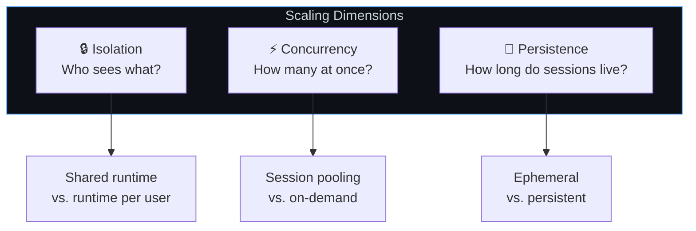
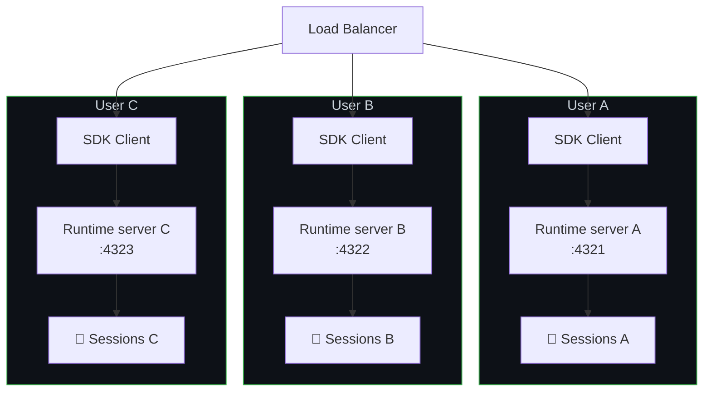
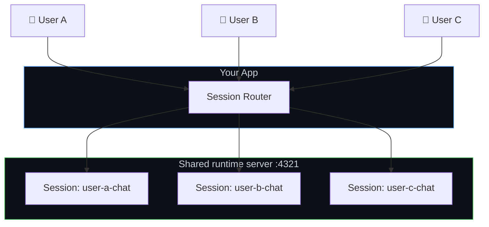
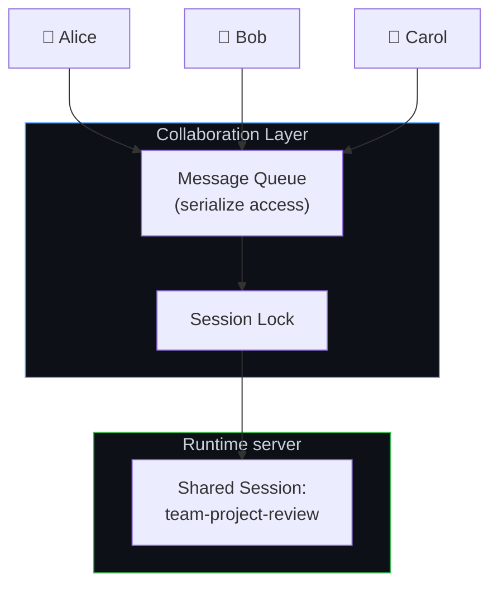
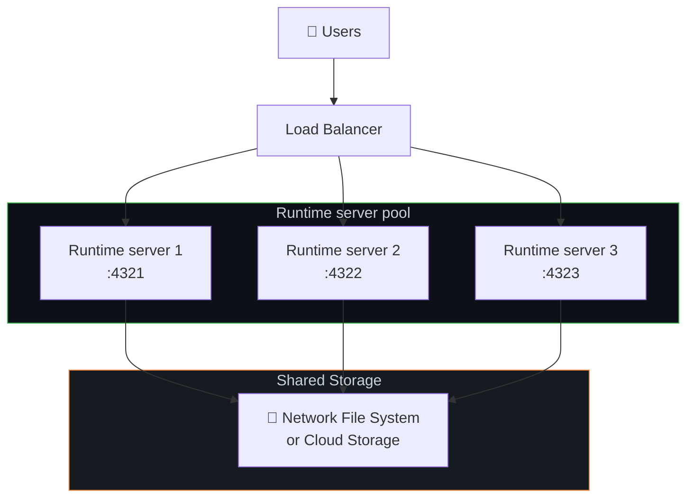
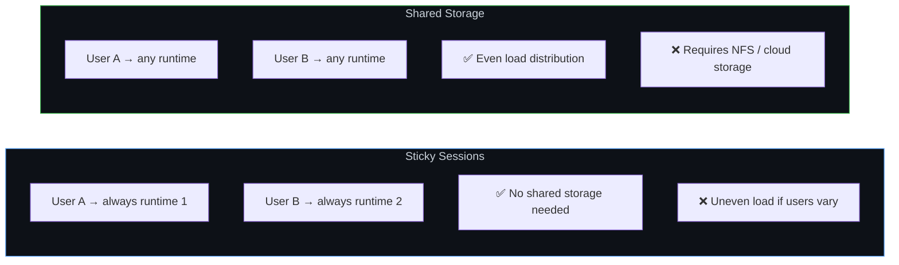
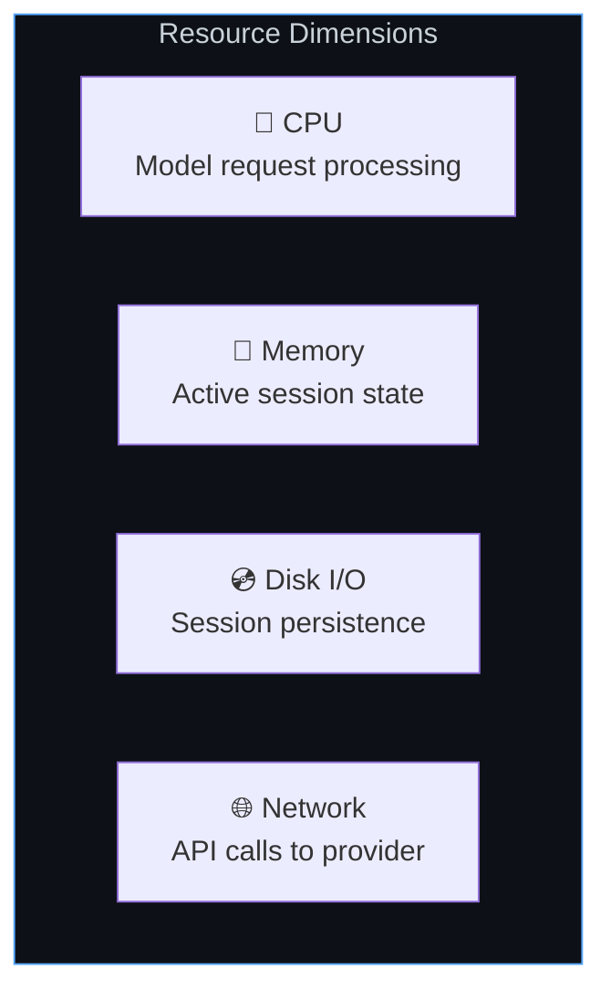
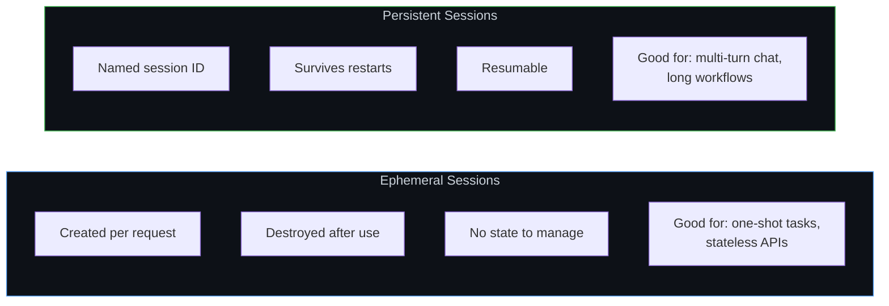
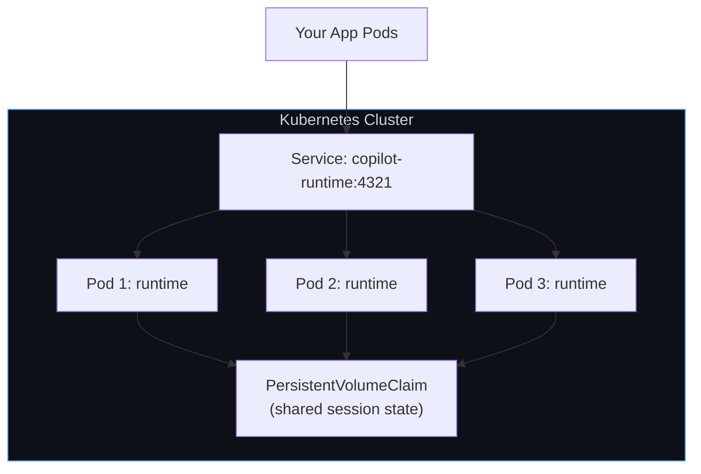
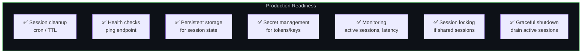

# Scaling and multi-tenancy

Design your Copilot SDK deployment to serve multiple users, handle concurrent sessions, and scale horizontally across infrastructure. This guide covers session isolation patterns, scaling topologies, and production best practices.

For SDK-level options and patterns, see [Multi-Tenancy & Server Deployments](./multi-tenancy.md).

**Best for:** Platform developers, SaaS builders, any deployment serving more than a handful of concurrent users.

## Core concepts

Before choosing a pattern, understand three dimensions of scaling:



## Session isolation patterns

### Pattern 1: isolated runtime per user

Each user gets their own runtime server instance. Strongest isolation—a user's sessions, memory, processes and on-disk state are completely separated. You don't need this pattern just to serve many users, because one runtime is multi-tenant (see pattern 2); use it when you need process-level isolation.



**When to use:**

- Multi-tenant SaaS where data isolation is critical
- Per-user process, filesystem or Copilot home separation
- Compliance requirements (SOC 2, HIPAA)

<!-- docs-validate: hidden -->

```typescript
import { CopilotClient, RuntimeConnection } from "copilot-sdk-supercharged";

declare function spawnRuntime(port: number, token?: string): Promise<void>;

class RuntimePool {
    private instances = new Map<string, { client: CopilotClient; port: number }>();
    private nextPort = 5000;

    async getClientForUser(userId: string, token?: string): Promise<CopilotClient> {
        if (this.instances.has(userId)) {
            return this.instances.get(userId)!.client;
        }

        const port = this.nextPort++;

        // Spawn a dedicated runtime server for this user, with its own port and COPILOT_HOME
        await spawnRuntime(port, token);

        const client = new CopilotClient({
            mode: "coding-agent",
            runtime: RuntimeConnection.forTcp("localhost", port),
        });

        this.instances.set(userId, { client, port });
        return client;
    }

    async releaseUser(userId: string): Promise<void> {
        const instance = this.instances.get(userId);
        if (instance) {
            await instance.client.stop();
            this.instances.delete(userId);
        }
    }
}
```

<!-- /docs-validate: hidden -->

```typescript
import { CopilotClient, RuntimeConnection } from "copilot-sdk-supercharged";

// Runtime pool manager — one runtime server per user
class RuntimePool {
    private instances = new Map<string, { client: CopilotClient; port: number }>();
    private nextPort = 5000;

    async getClientForUser(userId: string, token?: string): Promise<CopilotClient> {
        if (this.instances.has(userId)) {
            return this.instances.get(userId)!.client;
        }

        const port = this.nextPort++;

        // Spawn a dedicated runtime server for this user, with its own port and COPILOT_HOME
        await spawnRuntime(port, token);

        const client = new CopilotClient({
            mode: "coding-agent",
            runtime: RuntimeConnection.forTcp("localhost", port),
        });

        this.instances.set(userId, { client, port });
        return client;
    }

    async releaseUser(userId: string): Promise<void> {
        const instance = this.instances.get(userId);
        if (instance) {
            await instance.client.stop();
            this.instances.delete(userId);
        }
    }
}
```

### Pattern 2: shared runtime with session isolation

Multiple users share one runtime server, each with their own sessions. The runtime is multi-tenant: one instance serves many SDK clients and many concurrent sessions, and each session can carry its own credentials (`github.token`) and tool allowlist when clients use `mode: "empty"` (see [Multi-Tenancy & Server Deployments](./multi-tenancy.md)). Lighter on resources, but isolation is logical: sessions share one process, its filesystem access and its Copilot home, so your app must enforce which user can access which session.



**When to use:**

- Most multi-user backends, including per-user credentials
- Resource-constrained environments
- When logical (per-session) isolation is sufficient

```typescript
import { CopilotClient, RuntimeConnection, type CopilotSession } from "copilot-sdk-supercharged";

const sharedClient = new CopilotClient({
    mode: "coding-agent",
    runtime: RuntimeConnection.forTcp("localhost", 4321),
});

// Enforce session isolation through naming conventions
function getSessionId(userId: string, purpose: string): string {
    return `${userId}-${purpose}-${Date.now()}`;
}

// Access control: ensure users can only access their own sessions
async function resumeSessionWithAuth(sessionId: string, currentUserId: string): Promise<CopilotSession> {
    const [sessionUserId] = sessionId.split("-");
    if (sessionUserId !== currentUserId) {
        throw new Error("Access denied: session belongs to another user");
    }
    return sharedClient.resumeSession(sessionId, {});
}
```

### Pattern 3: shared sessions (collaborative)

Multiple users interact with the same session—like a shared chat room with Copilot.



**When to use:**

- Team collaboration tools
- Shared code review sessions
- Pair programming assistants

> ⚠️ **Important:** The SDK doesn't provide built-in session locking. You **must** serialize access to prevent concurrent writes to the same session.

<!-- docs-validate: hidden -->

```typescript
import { Redis } from "ioredis";

declare const app: {
    post(
        path: string,
        middleware: unknown,
        handler: (req: { body: { message: string } }, res: { json(body: unknown): void }) => Promise<void>,
    ): void;
};
declare const authMiddleware: unknown;

const redis = new Redis();

async function withSessionLock<T>(sessionId: string, fn: () => Promise<T>, timeoutSec = 300): Promise<T> {
    const lockKey = `session-lock:${sessionId}`;
    const lockId = crypto.randomUUID();

    // Acquire lock
    const acquired = await redis.set(lockKey, lockId, "EX", timeoutSec, "NX");
    if (!acquired) {
        throw new Error("Session is in use by another user");
    }

    try {
        return await fn();
    } finally {
        // Release lock (only if we still own it)
        const currentLock = await redis.get(lockKey);
        if (currentLock === lockId) {
            await redis.del(lockKey);
        }
    }
}

// Usage: serialize access to shared session
app.post("/team-chat", authMiddleware, async (req, res) => {
    const result = await withSessionLock("team-project-review", async () => {
        const session = await client.resumeSession("team-project-review", {});
        return session.sendAndWait({ prompt: req.body.message });
    });

    res.json({ content: result?.data.content });
});
```

<!-- /docs-validate: hidden -->

```typescript
import { Redis } from "ioredis";

const redis = new Redis();

async function withSessionLock<T>(sessionId: string, fn: () => Promise<T>, timeoutSec = 300): Promise<T> {
    const lockKey = `session-lock:${sessionId}`;
    const lockId = crypto.randomUUID();

    // Acquire lock
    const acquired = await redis.set(lockKey, lockId, "EX", timeoutSec, "NX");
    if (!acquired) {
        throw new Error("Session is in use by another user");
    }

    try {
        return await fn();
    } finally {
        // Release lock (only if we still own it)
        const currentLock = await redis.get(lockKey);
        if (currentLock === lockId) {
            await redis.del(lockKey);
        }
    }
}

// Usage: serialize access to shared session
app.post("/team-chat", authMiddleware, async (req, res) => {
    const result = await withSessionLock("team-project-review", async () => {
        const session = await client.resumeSession("team-project-review", {});
        return session.sendAndWait({ prompt: req.body.message });
    });

    res.json({ content: result?.data.content });
});
```

## Comparison of isolation patterns

|                      | Isolated Runtime Per User             | Shared Runtime + Session Isolation | Shared Sessions             |
| -------------------- | ------------------------------------- | ---------------------------------- | --------------------------- |
| **Isolation**        | ✅ Process-level                      | ⚠️ Logical (per session)           | ❌ Shared                   |
| **Resource usage**   | High (runtime per user)               | Low (one runtime)                  | Low (one runtime + session) |
| **Complexity**       | Medium                                | Low                                | High (locking)              |
| **Auth flexibility** | ✅ Per-user tokens                    | ✅ Per-session tokens              | ⚠️ One identity per session |
| **Best for**         | Strict compliance / process isolation | Multi-user apps and SaaS backends  | Collaboration               |

## Horizontal scaling

### Multiple runtime servers behind a load balancer



**Key requirement:** Session state must be on **shared storage** so any runtime server can resume any session.

<!-- docs-validate: hidden -->

```typescript
import { CopilotClient, RuntimeConnection } from "copilot-sdk-supercharged";

declare const app: {
    post(
        path: string,
        handler: (
            req: {
                user: { id: string };
                body: { message: string; prompt: string; sessionId: string };
            },
            res: { json(body: unknown): void },
        ) => Promise<void>,
    ): void;
};

class RuntimeLoadBalancer {
    private servers: string[];
    private currentIndex = 0;

    constructor(servers: string[]) {
        this.servers = servers;
    }

    // Round-robin selection
    getNextServer(): string {
        const server = this.servers[this.currentIndex];
        this.currentIndex = (this.currentIndex + 1) % this.servers.length;
        return server;
    }

    // Sticky sessions: same user always hits same server
    getServerForUser(userId: string): string {
        const hash = this.hashCode(userId);
        return this.servers[hash % this.servers.length];
    }

    private hashCode(str: string): number {
        let hash = 0;
        for (let i = 0; i < str.length; i++) {
            hash = (hash << 5) - hash + str.charCodeAt(i);
            hash |= 0;
        }
        return Math.abs(hash);
    }
}

const lb = new RuntimeLoadBalancer(["runtime-1", "runtime-2", "runtime-3"]);

app.post("/chat", async (req, res) => {
    const server = lb.getServerForUser(req.user.id);
    const client = new CopilotClient({ mode: "coding-agent", runtime: RuntimeConnection.forTcp(server, 4321) });

    const session = await client.createSession({
        sessionId: `user-${req.user.id}-chat`,
        model: "auto",
    });

    const response = await session.sendAndWait({ prompt: req.body.message });
    res.json({ content: response?.data.content });
});
```

<!-- /docs-validate: hidden -->

```typescript
import { CopilotClient, RuntimeConnection } from "copilot-sdk-supercharged";

// Route sessions to runtime servers
class RuntimeLoadBalancer {
    private servers: string[];
    private currentIndex = 0;

    constructor(servers: string[]) {
        this.servers = servers;
    }

    // Round-robin selection
    getNextServer(): string {
        const server = this.servers[this.currentIndex];
        this.currentIndex = (this.currentIndex + 1) % this.servers.length;
        return server;
    }

    // Sticky sessions: same user always hits same server
    getServerForUser(userId: string): string {
        const hash = this.hashCode(userId);
        return this.servers[hash % this.servers.length];
    }

    private hashCode(str: string): number {
        let hash = 0;
        for (let i = 0; i < str.length; i++) {
            hash = (hash << 5) - hash + str.charCodeAt(i);
            hash |= 0;
        }
        return Math.abs(hash);
    }
}

const lb = new RuntimeLoadBalancer(["runtime-1", "runtime-2", "runtime-3"]);

app.post("/chat", async (req, res) => {
    const server = lb.getServerForUser(req.user.id);
    const client = new CopilotClient({ mode: "coding-agent", runtime: RuntimeConnection.forTcp(server, 4321) });

    const session = await client.createSession({
        sessionId: `user-${req.user.id}-chat`,
        model: "auto",
    });

    const response = await session.sendAndWait({ prompt: req.body.message });
    res.json({ content: response?.data.content });
});
```

### Sticky sessions vs. shared storage



**Sticky sessions** are simpler—pin users to specific runtime servers. No shared storage needed, but load distribution is uneven.

**Shared storage** enables any runtime server to handle any session. Better load distribution, but requires networked storage for `~/.copilot/session-state/`.

## Vertical scaling

### Tuning a single runtime server

A single runtime server is multi-tenant and can handle many concurrent sessions. Key considerations:



**Session lifecycle management** is key to vertical scaling:

```typescript
import type { CopilotSession } from "copilot-sdk-supercharged";

// Limit concurrent active sessions
class SessionManager {
    private activeSessions = new Map<string, CopilotSession>();
    private maxConcurrent: number;

    constructor(maxConcurrent = 50) {
        this.maxConcurrent = maxConcurrent;
    }

    async getSession(sessionId: string): Promise<CopilotSession> {
        // Return existing active session
        if (this.activeSessions.has(sessionId)) {
            return this.activeSessions.get(sessionId)!;
        }

        // Enforce concurrency limit
        if (this.activeSessions.size >= this.maxConcurrent) {
            await this.evictOldestSession();
        }

        // Create or resume
        const session = await client.createSession({
            sessionId,
            model: "auto",
        });

        this.activeSessions.set(sessionId, session);
        return session;
    }

    private async evictOldestSession(): Promise<void> {
        const [oldestId] = this.activeSessions.keys();
        const session = this.activeSessions.get(oldestId)!;
        // Session state is persisted automatically — safe to disconnect
        await session.disconnect();
        this.activeSessions.delete(oldestId);
    }
}
```

## Ephemeral vs. persistent sessions



### Ephemeral sessions

For stateless API endpoints where each request is independent:

<!-- docs-validate: hidden -->

```typescript
declare const app: {
    post(
        path: string,
        handler: (
            req: { user: { id: string }; body: { message: string; prompt: string; sessionId: string } },
            res: { json(body: unknown): void },
        ) => Promise<void>,
    ): void;
};

app.post("/api/analyze", async (req, res) => {
    const session = await client.createSession({
        model: "auto",
    });

    try {
        const response = await session.sendAndWait({
            prompt: req.body.prompt,
        });
        res.json({ result: response?.data.content });
    } finally {
        await session.disconnect(); // Clean up immediately
    }
});
```

<!-- /docs-validate: hidden -->

```typescript
app.post("/api/analyze", async (req, res) => {
    const session = await client.createSession({
        model: "auto",
    });

    try {
        const response = await session.sendAndWait({
            prompt: req.body.prompt,
        });
        res.json({ result: response?.data.content });
    } finally {
        await session.disconnect(); // Clean up immediately
    }
});
```

### Persistent sessions

For conversational interfaces or long-running workflows:

<!-- docs-validate: hidden -->

```typescript
declare const app: {
    post(
        path: string,
        handler: (
            req: {
                user: { id: string };
                body: { message: string; prompt: string; sessionId: string };
            },
            res: { json(body: unknown): void },
        ) => Promise<void>,
    ): void;
};

// Create a resumable session
app.post("/api/chat/start", async (req, res) => {
    const sessionId = `user-${req.user.id}-${Date.now()}`;

    const session = await client.createSession({
        sessionId,
        model: "auto",
        state: {
            infiniteSessions: {
                enabled: true,
                backgroundCompactionThreshold: 0.8,
            },
        },
    });

    res.json({ sessionId });
});

// Continue the conversation
app.post("/api/chat/message", async (req, res) => {
    const session = await client.resumeSession(req.body.sessionId, {});
    const response = await session.sendAndWait({ prompt: req.body.message });

    res.json({ content: response?.data.content });
});

// Clean up when done
app.post("/api/chat/end", async (req, res) => {
    await client.deleteSession(req.body.sessionId);
    res.json({ success: true });
});
```

<!-- /docs-validate: hidden -->

```typescript
// Create a resumable session
app.post("/api/chat/start", async (req, res) => {
    const sessionId = `user-${req.user.id}-${Date.now()}`;

    const session = await client.createSession({
        sessionId,
        model: "auto",
        state: {
            infiniteSessions: {
                enabled: true,
                backgroundCompactionThreshold: 0.8,
            },
        },
    });

    res.json({ sessionId });
});

// Continue the conversation
app.post("/api/chat/message", async (req, res) => {
    const session = await client.resumeSession(req.body.sessionId, {});
    const response = await session.sendAndWait({ prompt: req.body.message });

    res.json({ content: response?.data.content });
});

// Clean up when done
app.post("/api/chat/end", async (req, res) => {
    await client.deleteSession(req.body.sessionId);
    res.json({ success: true });
});
```

## Container deployments

### Kubernetes with persistent storage

```yaml
apiVersion: apps/v1
kind: Deployment
metadata:
    name: copilot-runtime
spec:
    replicas: 3
    selector:
        matchLabels:
            app: copilot-runtime
    template:
        metadata:
            labels:
                app: copilot-runtime
        spec:
            containers:
                - name: copilot-runtime
                  image: your-registry/copilot-runtime:latest # See backend-services.md for how to build and push this image
                  args: ["--host", "0.0.0.0", "--port", "4321"] # The image entrypoint already passes --server
                  env:
                      - name: COPILOT_GITHUB_TOKEN
                        valueFrom:
                            secretKeyRef:
                                name: copilot-secrets
                                key: github-token
                      # A non-loopback bind (--host 0.0.0.0) requires a connection token,
                      # or the server refuses to start. Clients pass the same value as
                      # `connectionToken` to RuntimeConnection.forTcp (see backend-services.md).
                      - name: COPILOT_CONNECTION_TOKEN
                        valueFrom:
                            secretKeyRef:
                                name: copilot-secrets
                                key: connection-token
                  ports:
                      - containerPort: 4321
                  volumeMounts:
                      - name: session-state
                        mountPath: /root/.copilot/session-state
            volumes:
                - name: session-state
                  persistentVolumeClaim:
                      claimName: copilot-sessions-pvc
---
apiVersion: v1
kind: Service
metadata:
    name: copilot-runtime
spec:
    selector:
        app: copilot-runtime
    ports:
        - port: 4321
          targetPort: 4321
```



### Azure Container Instances

```yaml
containers:
    - name: copilot-runtime
      image: your-registry/copilot-runtime:latest # See backend-services.md for how to build and push this image
      command: ["copilot-runtime", "--server", "--host", "0.0.0.0", "--port", "4321"]
      # A non-loopback bind (--host 0.0.0.0) requires COPILOT_CONNECTION_TOKEN to be
      # set to a non-empty value, or the server refuses to start. Supply it from your
      # secret store and pass the same value as `connectionToken` from the SDK client.
      environmentVariables:
          - name: COPILOT_GITHUB_TOKEN
            secureValue: your-github-token
          - name: COPILOT_CONNECTION_TOKEN
            secureValue: your-connection-token
      volumeMounts:
          - name: session-storage
            mountPath: /root/.copilot/session-state

volumes:
    - name: session-storage
      azureFile:
          shareName: copilot-sessions
          storageAccountName: myaccount
```

## Production checklist



| Concern             | Recommendation                                                |
| ------------------- | ------------------------------------------------------------- |
| **Session cleanup** | Run periodic cleanup to delete sessions older than your TTL   |
| **Health checks**   | Ping the runtime server periodically; restart if unresponsive |
| **Storage**         | Mount persistent volumes for `~/.copilot/session-state/`      |
| **Secrets**         | Use your platform's secret manager (Vault, K8s Secrets, etc.) |
| **Monitoring**      | Track active session count, response latency, error rates     |
| **Locking**         | Use Redis or similar for shared session access                |
| **Shutdown**        | Drain active sessions before stopping runtime servers         |

## Limitations

| Limitation                            | Details                                                                                                                          |
| ------------------------------------- | -------------------------------------------------------------------------------------------------------------------------------- |
| **No built-in session locking**       | Implement application-level locking for concurrent access                                                                        |
| **No built-in load balancing**        | Use external LB or service mesh                                                                                                  |
| **Session state is file-based**       | Requires shared filesystem for multi-server setups                                                                               |
| **No idle timeout by default**        | Pass `--session-idle-timeout <seconds>` to the runtime server to automatically clean up inactive sessions                        |
| **One runtime server is one process** | It serves many sessions, but scale beyond one machine (or remove the single point of failure) by adding runtime server instances |

## Next steps

- **[Session Persistence](../features/session-persistence.md)**: Deep dive on resumable sessions
- **[Backend Services](./backend-services.md)**: Core server-side setup
- **[GitHub OAuth](./github-oauth.md)**: Multi-user authentication
- **[BYOK](../auth/byok.md)**: Use your own model provider
